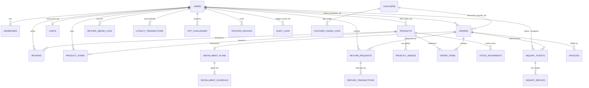
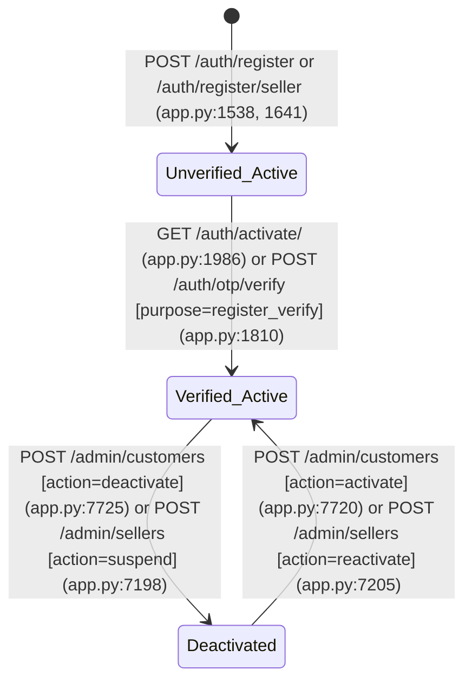
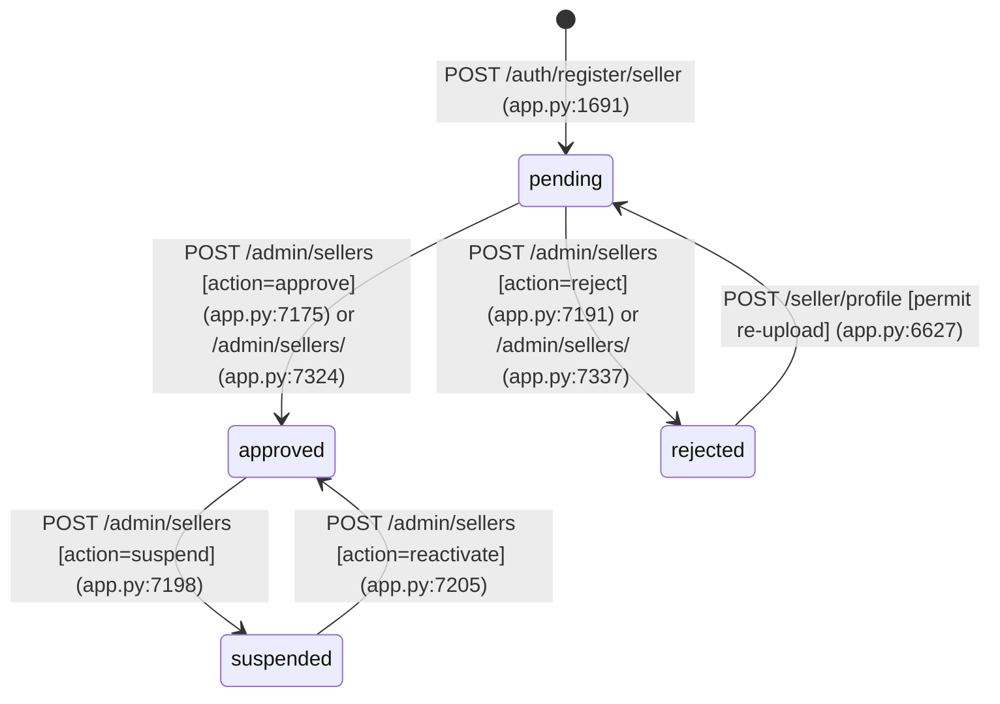
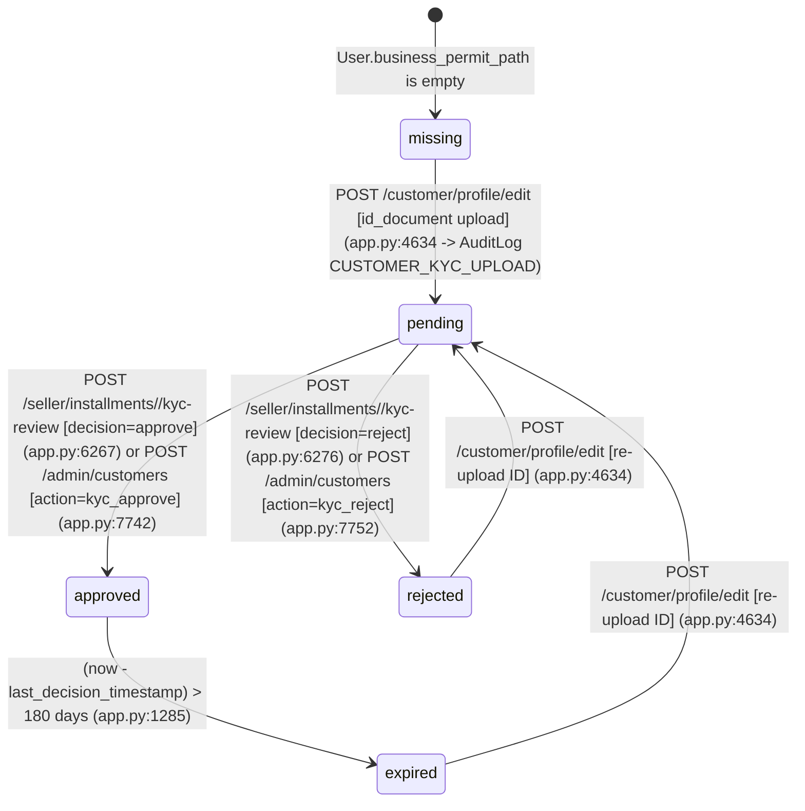
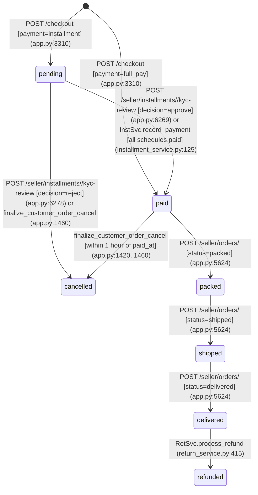
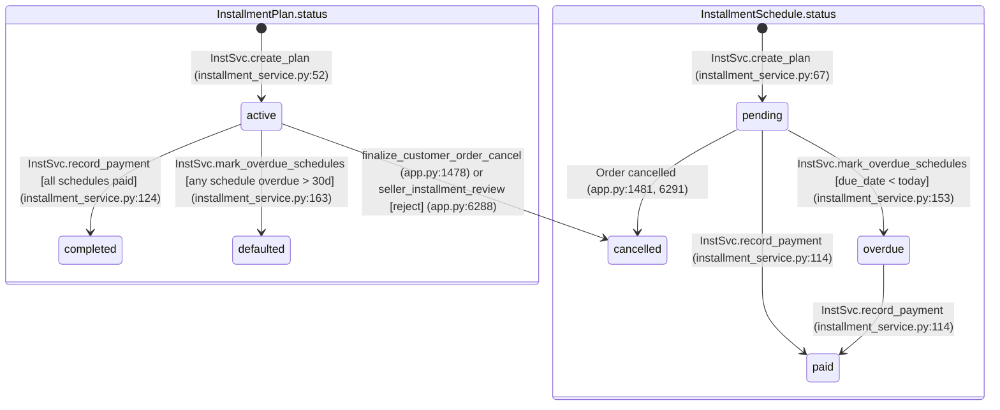
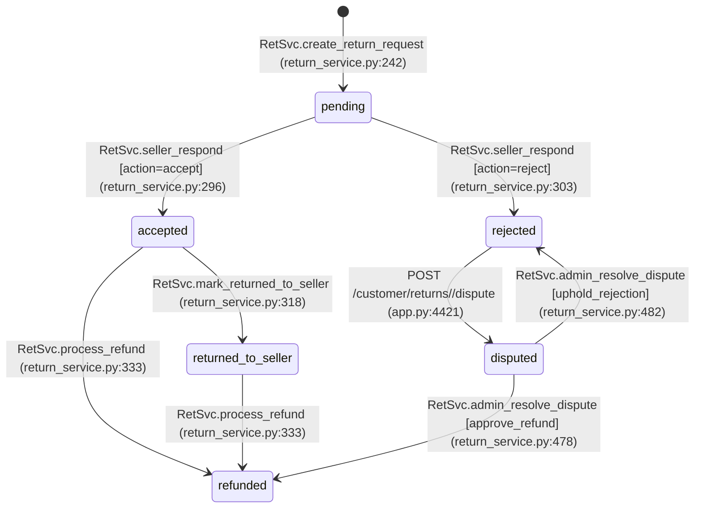

# E-ACIS End-to-End Architecture, QA, Financial & Security Audit Report

- **Audit Date:** October 30, 2026
- **System Audited:** E-ACIS (Electronic Appliance Commerce & Installment System)
- **Audit Mode:** Strictly Read-Only (`instance/audit_copy.db` + static AST/schema/template analysis + dynamic Flask `test_client()` verification)
- **Database Verified:** `instance/audit_copy.db` (isolated copy of `instance/eacis_dev.db`; original database untouched)
- **Mail Mode:** `file` (`audit/logs/mail`) — zero external emails or third-party requests sent

---

## 1. Executive Summary

### 1.1 Overall System Health Score: **5.8 / 10**

| Domain | Score | Summary Assessment |
| :--- | :---: | :--- |
| **Authentication & OTP Core** | **7.2 / 10** | Strong PBKDF2/Werkzeug password hashing, HMAC-SHA256 OTP challenges with attempt limits, cooldowns, and trusted-device cookies; weakened by spoofable `X-Forwarded-For` IP lockouts, committed SMTP credentials in `.env`, and open-redirect vectors. |
| **Role-Based Access Control (RBAC)** | **5.5 / 10** | Prefix guard (`enforce_portal_guards`) protects top-level `/customer`, `/seller`, and `/admin` routes, but misses `/uploads/permits/*` (cross-seller KYC/permit IDOR), `/seller/inquiries/<ticket_ref>` (cross-seller ticket hijacking), suspended sellers (`seller_verification_status == 'suspended'`), and unverified customer sessions. |
| **Catalog, Cart & Checkout** | **6.5 / 10** | Rich appliance catalog, stock deduction + `StockMovement` logging, and multi-channel checkout; undermined by partial-cart checkout wiping unselected items, lack of `SELECT ... FOR UPDATE` row locking on stock/vouchers, and orphaned multi-seller orders. |
| **Installments, Payments & Invoicing** | **5.0 / 10** | `Decimal` schedule generation with `ROUND_HALF_UP` and remainder correction on the final month works well for new orders, but Seller KYC review prematurely marks unpaid installment orders and invoices as `paid`, multi-seller payouts double-count 100% of `Order.total` per seller, and seeded installment schedules drift from `total_financed`. |
| **Returns, Refunds & Disputes** | **3.5 / 10** | **Broken in production:** Seller refund crashes with `NameError: name 'finalize_seller_refund' is not defined` due to a missing `def` header at `eacis/app.py:1494`; installment refunds pay out 100% of `order.total` even when ₱0 was paid while leaving the installment plan active; return evidence images (`returns/<file>`) have no serving route (`404 Not Found`). |
| **Database & Schema Integrity** | **6.0 / 10** | 24 well-structured SQLAlchemy models and unified Alembic migration head (`b8a91e4f02d1`), but 27 foreign-key columns lack indexes, SQLite `PRAGMA foreign_keys=ON` is never enabled, and 92 `float()` conversions in `eacis/app.py` risk centavo drift. |
| **Code Maintainability & Architecture** | **4.5 / 10** | Entire application (143 routes, 182 functions) lives inside a single 8,213-line `create_app()` function in `eacis/app.py` with 66 silent `except Exception: pass` blocks, 3 duplicate helper definitions, and 57 deprecated `datetime.utcnow()` calls. |
| **Frontend, Templates & UX** | **7.0 / 10** | Clean modern storefront and SaaS dashboards for Seller and Admin; impacted by missing CSRF tokens on 2 trusted-device revocation forms, unescaped `.innerHTML` DOM XSS sinks in JS/templates, a broken `customer_addresses.edit_address` endpoint reference, and mismatched Admin OTP dashboard keys. |

---

### 1.2 Top 5 Highest-Priority Risks

1. **[`LOGIC-01`] (Critical) Seller Refund Flow Crashes with `500 NameError` & 34 Lines of Unreachable Dead Code (`eacis/app.py:1494-1527`, `1889`, `5779`):**
   The function header `def finalize_seller_refund(seller, rrt_ref):` was accidentally omitted inside `finalize_customer_order_cancel()`, turning lines 1494–1527 into unreachable dead code after `return False, ...` on line 1492. Every seller attempt to process a refund (either directly or after OTP verification) crashes with `NameError: name 'finalize_seller_refund' is not defined`.
2. **[`LOGIC-02`] (Critical) Installment Order Refunds Pay Out 100% of Financed `order.total` Regardless of Amount Actually Paid, Leave `InstallmentPlan` Active, and Claw Back Unearned Loyalty Points (`eacis/app.py:434-472`, `eacis/services/return_service.py:324-463`):**
   Refunding an installment order refunds the entire `order.total` (e.g., ₱8,249.00) even when the buyer has paid ₱0.00 or only 1 installment, never cancels the `InstallmentPlan` or pending `InstallmentSchedule` rows, and deducts loyalty points the installment buyer never earned at checkout.
3. **[`SEC-01`] (Critical) Cross-Tenant IDOR in `/uploads/permits/<path:filename>` (All Seller Permits & Customer KYC IDs) and `/seller/inquiries/<ticket_ref>` (`eacis/app.py:657-690`, `6421-6466`):**
   Any authenticated seller account—including a newly registered `pending`, `rejected`, or `suspended` seller—can download any other seller's business/mayor's/barangay permits and any customer's government KYC ID document via `/uploads/permits/<filename>`, and any approved seller can read, reply to, or hijack any other seller's customer inquiry ticket via `/seller/inquiries/<ticket_ref>`.
4. **[`SEC-08`] (Critical) Live Gmail SMTP App Password & Weak Default Secrets Committed in Plaintext in `eacis/.env` (`eacis/.env:3,32-33,47`, `eacis/config.py:32,55`):**
   `eacis/.env` contains a real Gmail address (`eapplianccommerce@gmail.com`) and 16-character App Password (`cmra udys igwg bxzr`) alongside `SECRET_KEY=dev-secret` and `OTP_SECRET_PEPPER=change-this-in-production`.
5. **[`LOGIC-03`] (High) Multi-Seller Order Fulfillment Deadlock & 100% Order-Total Payout Inflation (`eacis/app.py:5612-5622`, `6822-6827`, `7404-7408`):**
   Checkout creates a single `Order` across multiple sellers, but `seller_order_detail` blocks sellers from marking any multi-seller order as `shipped` or `delivered` ("Please coordinate with admin"), while the Admin portal has zero order-management routes—permanently deadlocking multi-seller orders. Worse, `seller_payouts()` and `admin_seller_detail()` sum `float(o.total)` (the entire multi-seller order total) into **every** participating seller's balance and LTV.

---

### 1.3 What Is Solid & Working Well

- **Cryptographic OTP & Trusted-Device Design (`eacis/services/otp_service.py`):** OTP codes are generated using `secrets.choice`, hashed with HMAC-SHA256 + server pepper (`OTP_SECRET_PEPPER`), scoped by `(user_id, email, purpose)`, and protected by per-challenge attempt limits (`max_attempts=5`), resend cooldowns (`60s`), and SHA-256 hashed `TrustedDevice` tokens.
- **Upload Magic-Byte & Image Verification (`eacis/app.py:114-180`, `1150-1245`, `5248-5413`):** Avatar, permit, return evidence, and product image upload helpers check magic bytes (`%PDF-`, PNG, JPEG, WebP signatures), enforce byte-size caps, strip path traversal via `secure_filename()`, and re-verify images via Pillow `Image.verify()`.
- **Installment Plan Decimal Math (`eacis/services/installment_service.py:18-76`):** `create_plan()` uses `Decimal` with `ROUND_HALF_UP` and assigns the exact centavo remainder `remaining - (monthly * (months - 1))` to the final installment schedule so `sum(schedules.amount) == total_financed`.
- **Return Abuse Scoring Engine (`eacis/services/return_service.py:45-190`):** Weighted rolling-window abuse scoring (`ReturnAbuseLog`) with automatic flagging (`>= 10`) and return restriction (`>= 20`) is thoughtfully designed for high-value appliance commerce.
- **Modern Responsive Storefront & SaaS Portals (`eacis/templates/`):** Unified brand system, responsive storefront hero/catalog, and dedicated SaaS sidebar + KPI/table layouts for Seller and Admin portals.

---

## 2. Phase 0: System Map & Architecture Inventory

### 2.1 High-Level Inventory Summary

| Component Type | Count | Primary Locations |
| :--- | :---: | :--- |
| **HTTP Routes / Endpoints** | **143 routes** (135 unique endpoints) | `eacis/app.py` (all defined inside `create_app()`) |
| **SQLAlchemy Models / Tables** | **24 models** (24 tables + `alembic_version`) | `eacis/models/*.py` |
| **Service Modules** | **6 modules** | `eacis/services/` (`installment_service.py`, `inventory_service.py`, `loyalty_service.py`, `otp_service.py`, `return_service.py`, `voucher_service.py` + `review_service.py`) |
| **Jinja2 Templates** | **62 templates** | `eacis/templates/` (`admin/`, `auth/`, `customer/`, `errors/`, `partials/`, `public/`, `seller/`, `static_pages/`) |
| **Alembic Migrations** | **7 revisions** (1 unified head `b8a91e4f02d1`) | `migrations/versions/` |
| **Automated Pytest Suite** | **7 test files** (23 test cases) | `eacis/tests/` |
| **Background Jobs / Workers** | **0** | None (all OTP emails, overdue checks, and reports run synchronously inside HTTP requests) |

---

### 2.2 Complete Route Inventory & Role Matrix (All 143 Routes)

#### Legend for Role Permission Matrix
- **G:** Guest (Unauthenticated)
- **CU:** Customer (Unverified Email, `email_verified_at IS NULL`)
- **CV:** Customer (Verified Email, No/Expired KYC)
- **CK:** Customer (Verified Email + Fresh Approved KYC <= 180 days)
- **SP / SR:** Seller (`pending` or `rejected` verification status)
- **SS:** Seller (`suspended` status; note: if `is_active=True` or session active, bypasses `/seller` status check — see `SEC-03`)
- **SA:** Seller (`approved` verification status)
- **AD:** Admin (`role == 'admin'`)
- Symbols: `ALW` = Allowed (`200`/`302` action), `DEN` = Denied (redirects to login/portal home or `403`/`404`), `BUG` = Unintended access / broken route (`SEC-*` / `LOGIC-*` / `UI-*`).

#### 2.2.1 Public, Storefront, Cart & API Routes

| Method(s) | Path | Endpoint | Line | G | CU | CV | CK | SP/SR | SS | SA | AD | Notes / Guards |
| :--- | :--- | :--- | :---: | :---: | :---: | :---: | :---: | :---: | :---: | :---: | :---: | :--- |
| `GET` | `/` | `home` | 972 | ALW | ALW | ALW | ALW | ALW | ALW | ALW | ALW | Public homepage (`build_landing_context`) |
| `GET` | `/landing` | `landing` | 978 | ALW | ALW | ALW | ALW | ALW | ALW | ALW | ALW | Alias for homepage |
| `GET` | `/shop`, `/customer/shop` | `shop` | 2124 | ALW | ALW | ALW | ALW | ALW | ALW | ALW | ALW | Catalog search, category, price & sort filters |
| `GET` | `/product/<ref>`, `/customer/product/<ref>` | `product_detail` | 2283 | ALW | ALW | ALW | ALW | ALW | ALW | ALW | ALW | Product detail, installment calculator, reviews |
| `POST` | `/product/<ref>/star` | `product_toggle_star` | 2497 | DEN | BUG | ALW | ALW | DEN | DEN | DEN | DEN | Requires delivered order (`has_user_received_product`) |
| `POST` | `/product/<ref>/review` | `product_create_review` | 2566 | DEN | BUG | ALW | ALW | DEN | DEN | DEN | DEN | Requires delivered order; open redirect in `next` (`SEC-04`) |
| `GET, POST` | `/cart`, `/customer/cart` | `cart` | 2627 | DEN | BUG | ALW | ALW | DEN | DEN | DEN | DEN | Customer only; does not check `email_verified_at` (`SEC-09`) |
| `POST` | `/cart/apply-voucher`, `/customer/cart/apply-voucher` | `cart_apply_voucher` | 2755 | DEN | BUG | ALW | ALW | DEN | DEN | DEN | DEN | Validates voucher & stores code in `Cart.voucher_code` |
| `POST` | `/cart/remove-voucher`, `/customer/cart/remove-voucher` | `cart_remove_voucher` | 2816 | DEN | BUG | ALW | ALW | DEN | DEN | DEN | DEN | Clears `Cart.voucher_code` |
| `GET, POST` | `/checkout`, `/customer/checkout` | `checkout` | 2834 | DEN | BUG | ALW | ALW | DEN | DEN | DEN | DEN | `full_pay` allowed for CV/CK; `installment` requires CK + OTP + `>=1` completed order (`LOGIC-06`, `LOGIC-07`) |
| `GET` | `/api/session` | `api_session` | 609 | ALW | ALW | ALW | ALW | ALW | ALW | ALW | ALW | Returns `{authenticated, role, id}` |
| `GET` | `/api/products/Suggest`, `/api/products/suggest` | `api_products_suggest` | 692 | ALW | ALW | ALW | ALW | ALW | ALW | ALW | ALW | Autocomplete JSON API |
| `GET` | `/api/cart/summary` | `api_cart_summary` | 711 | ALW | ALW | ALW | ALW | ALW | ALW | ALW | ALW | Cart drawer JSON summary |
| `GET` | `/postal_lookup` | `postal_lookup_api` | 343 | ALW | ALW | ALW | ALW | ALW | ALW | ALW | ALW | Hardcoded 7-city lookup dict |
| `GET` | `/uploads/avatars/<role>/<int:user_id>` | `serve_avatar` | 620 | ALW | ALW | ALW | ALW | ALW | ALW | ALW | ALW | Public avatar serving |
| `GET` | `/uploads/products/<path:filename>` | `serve_product_image` | 656 | ALW | ALW | ALW | ALW | ALW | ALW | ALW | ALW | Public product image serving |
| `GET` | `/uploads/permits/<path:filename>` | `serve_permit` | 661 | DEN | BUG | BUG | BUG | **BUG** | **BUG** | **BUG** | ALW | **IDOR (`SEC-01`):** Any seller (even `pending`/`rejected`) can read ANY seller permit or customer KYC ID! |
| `GET` | `/about`, `/privacy`, `/terms`, `/cookies`, `/shipping-returns`, `/warranty`, `/installment-guide`, `/accessibility`, `/careers`, `/press`, `/sustainability`, `/investor-relations`, `/help`, `/track-order`, `/faqs`, `/contact`, `/report-vulnerability` | Static pages | 983–2047 | ALW | ALW | ALW | ALW | ALW | ALW | ALW | ALW | Static informational pages |

#### 2.2.2 Authentication & OTP Routes

| Method(s) | Path | Endpoint | Line | G | CU | CV | CK | SP/SR | SS | SA | AD | Notes / Guards |
| :--- | :--- | :--- | :---: | :---: | :---: | :---: | :---: | :---: | :---: | :---: | :---: | :--- |
| `GET, POST` | `/auth/login`, `/login` | `auth_login` | 1029 | ALW | ALW | ALW | ALW | ALW | DEN | ALW | ALW | Spoofable `X-Forwarded-For` lockout (`SEC-07`); `//evil.com` open redirect (`SEC-04`) |
| `GET, POST` | `/auth/register`, `/register` | `auth_register` | 1538 | ALW | ALW | ALW | ALW | ALW | ALW | ALW | ALW | Customer registration + activation link / OTP |
| `GET, POST` | `/auth/register/seller`, `/register/seller` | `auth_register_seller` | 1641 | ALW | ALW | ALW | ALW | ALW | ALW | ALW | ALW | Seller registration + permit upload + OTP |
| `GET, POST` | `/auth/otp/verify` | `auth_otp_verify` | 1740 | ALW | ALW | ALW | ALW | ALW | ALW | ALW | ALW | Crashes with `500 NameError` when `purpose == 'seller_refund'` (`LOGIC-01`) |
| `POST` | `/auth/otp/resend` | `auth_otp_resend` | 1938 | ALW | ALW | ALW | ALW | ALW | ALW | ALW | ALW | Enforces 60s cooldown & hourly cap |
| `GET` | `/auth/activate/<token>` | `auth_activate_token` | 1986 | ALW | ALW | ALW | ALW | ALW | ALW | ALW | ALW | Single-click email activation token |
| `GET, POST` | `/auth/forgot-password` | `auth_forgot_password` | 1196 | ALW | ALW | ALW | ALW | ALW | ALW | ALW | ALW | Password reset OTP initiation |
| `GET, POST` | `/auth/reset-password` | `auth_reset_password` | 1246 | ALW | ALW | ALW | ALW | ALW | ALW | ALW | ALW | Sets new password after OTP verification |
| `GET, POST` | `/auth/logout`, `/logout` | `auth_logout` | 1972 | ALW | ALW | ALW | ALW | ALW | ALW | ALW | ALW | Accepts `GET` logout (CSRF-able logout) |

#### 2.2.3 Customer Portal Routes (`/customer/*`)

| Method(s) | Path | Endpoint | Line | G | CU | CV | CK | SP/SR | SS | SA | AD | Notes / Guards |
| :--- | :--- | :--- | :---: | :---: | :---: | :---: | :---: | :---: | :---: | :---: | :---: | :--- |
| `GET` | `/customer/checkout/success` | `checkout_success` | 3655 | DEN | BUG | ALW | ALW | DEN | DEN | DEN | DEN | Displays false loyalty points for installment orders (`LOGIC-08`) |
| `GET` | `/customer/orders`, `/orders` | `customer_orders` | 3515 | DEN | BUG | ALW | ALW | DEN | DEN | DEN | DEN | Lists buyer's orders |
| `GET` | `/customer/orders/<order_ref>` | `customer_order_detail` | 3789 | DEN | BUG | ALW | ALW | DEN | DEN | DEN | DEN | Order detail, timeline, invoice & installment summary |
| `POST` | `/customer/orders/<order_ref>/cancel` | `customer_order_cancel` | 3698 | DEN | BUG | ALW | ALW | DEN | DEN | DEN | DEN | Allows cancelling `pending` or `paid` (within 1h) after OTP |
| `GET` | `/customer/orders/<order_ref>/invoice` | `customer_order_invoice` | 3923 | DEN | BUG | ALW | ALW | DEN | DEN | DEN | DEN | Renders HTML invoice |
| `GET` | `/customer/orders/<order_ref>/invoice/download` | `customer_order_invoice_download` | 3953 | DEN | BUG | ALW | ALW | DEN | DEN | DEN | DEN | Downloads printable HTML invoice |
| `GET` | `/customer/installments`, `/installments` | `customer_installments` | 4002 | DEN | BUG | ALW | ALW | DEN | DEN | DEN | DEN | Lists customer's `InstallmentPlan`s |
| `GET` | `/customer/installments/<int:plan_id>` | `customer_installment_detail` | 4049 | DEN | BUG | ALW | ALW | DEN | DEN | DEN | DEN | Schedule breakdown & payment form |
| `POST` | `/customer/installments/<int:plan_id>/pay/<int:sched_id>` | `customer_installment_pay` | 4088 | DEN | BUG | ALW | ALW | DEN | DEN | DEN | DEN | Records schedule payment (`InstSvc.record_payment`) |
| `GET` | `/customer/payments` | `customer_payments` | 4135 | DEN | BUG | ALW | ALW | DEN | DEN | DEN | DEN | Unified payment history |
| `GET, POST` | `/customer/returns`, `/returns` | `customer_returns` | 4203 | DEN | BUG | ALW | ALW | DEN | DEN | DEN | DEN | Return request creation & list |
| `GET` | `/customer/returns/<rrt_ref>` | `customer_return_detail` | 4355 | DEN | BUG | ALW | ALW | DEN | DEN | DEN | DEN | Return detail |
| `POST` | `/customer/returns/<rrt_ref>/ship-back` | `customer_return_ship_back` | 4381 | DEN | BUG | ALW | ALW | DEN | DEN | DEN | DEN | Transitions `accepted` -> `returned_to_seller` |
| `POST` | `/customer/returns/<rrt_ref>/dispute` | `customer_return_dispute` | 4407 | DEN | BUG | ALW | ALW | DEN | DEN | DEN | DEN | Transitions `rejected` -> `disputed` |
| `GET, POST` | `/customer/inquiries` | `customer_inquiries` | 4435 | DEN | BUG | ALW | ALW | DEN | DEN | DEN | DEN | Support tickets list & create |
| `GET, POST` | `/customer/inquiries/<ticket_ref>` | `customer_inquiry_detail` | 4496 | DEN | BUG | ALW | ALW | DEN | DEN | DEN | DEN | Customer ticket thread |
| `GET` | `/customer/profile`, `/profile` | `customer_profile` | 4532 | DEN | BUG | ALW | ALW | DEN | DEN | DEN | DEN | Profile overview & KYC status |
| `GET, POST` | `/customer/profile/edit` | `customer_profile_edit` | 4557 | DEN | BUG | ALW | ALW | DEN | DEN | DEN | DEN | Profile, address & KYC ID upload |
| `POST` | `/customer/profile/avatar` | `customer_profile_avatar` | 4678 | DEN | BUG | ALW | ALW | DEN | DEN | DEN | DEN | Avatar upload |
| `GET, POST` | `/customer/addresses/save` | `customer_addresses_save` | 3566 | DEN | BUG | ALW | ALW | DEN | DEN | DEN | DEN | AJAX/form address save |
| `POST` | `/customer/addresses/<int:addr_id>/delete` | `customer_addresses_delete` | 3630 | DEN | BUG | ALW | ALW | DEN | DEN | DEN | DEN | Address delete |
| `GET, POST` | `/customer/security` | `customer_security` | 4700 | DEN | BUG | ALW | ALW | DEN | DEN | DEN | DEN | Password/email change with OTP |
| `GET, POST` | `/customer/trusted-devices` | `customer_trusted_devices` | 4802 | DEN | BUG | **BUG** | **BUG** | DEN | DEN | DEN | DEN | **Broken POST (`SEC-06`):** Template missing `csrf_token()` -> `400 Bad Request` |
| `GET` | `/customer/loyalty`, `/loyalty` | `customer_loyalty` | 4834 | DEN | BUG | ALW | ALW | DEN | DEN | DEN | DEN | Loyalty points & voucher redemption |
| `POST` | `/customer/loyalty/redeem` | `customer_loyalty_redeem` | 4911 | DEN | BUG | ALW | ALW | DEN | DEN | DEN | DEN | Redeems points for `LOYAL-*` voucher |

#### 2.2.4 Seller Portal Routes (`/seller/*`)

| Method(s) | Path | Endpoint | Line | G | CU/CV/CK | SP/SR | SS | SA | AD | Notes / Guards |
| :--- | :--- | :--- | :---: | :---: | :---: | :---: | :---: | :---: | :---: | :--- |
| `GET` | `/seller/dashboard`, `/seller` | `seller_dashboard` | 4970 | DEN | DEN | ALW | **BUG** | ALW | DEN | Unverified sellers (`SP/SR`) restricted to dashboard/profile/security; `SS` (`suspended`) bypasses if session active (`SEC-03`) |
| `GET` | `/seller/products` | `seller_products` | 5066 | DEN | DEN | DEN | **BUG** | ALW | DEN | Seller catalog table |
| `GET, POST` | `/seller/products/create` | `seller_product_create` | 5106 | DEN | DEN | DEN | **BUG** | ALW | DEN | Blocks `SP/SR`; creates product + initial stock movement |
| `GET, POST` | `/seller/products/<ref>/edit` | `seller_product_edit` | 5172 | DEN | DEN | DEN | **BUG** | ALW | DEN | Checks `product.seller_id == current_user.id` |
| `POST` | `/seller/products/<ref>/delete` | `seller_product_delete` | 5488 | DEN | DEN | DEN | **BUG** | ALW | DEN | Hard-deletes product if no `OrderItem` exists, else soft-deactivates |
| `POST` | `/seller/products/<ref>/images/upload` | `seller_product_image_upload` | 5248 | DEN | DEN | DEN | **BUG** | ALW | DEN | Multi-image upload |
| `POST` | `/seller/products/<ref>/images/<int:img_id>/delete` | `seller_product_image_delete` | 5415 | DEN | DEN | DEN | **BUG** | ALW | DEN | Image delete |
| `POST` | `/seller/products/<ref>/images/<int:img_id>/primary` | `seller_product_image_primary` | 5454 | DEN | DEN | DEN | **BUG** | ALW | DEN | Set primary gallery image |
| `GET` | `/seller/orders` | `seller_orders` | 5518 | DEN | DEN | DEN | **BUG** | ALW | DEN | Lists orders containing seller's items |
| `GET, POST` | `/seller/orders/<order_ref>` | `seller_order_detail` | 5563 | DEN | DEN | DEN | **BUG** | ALW | DEN | **Bugs (`LOGIC-03`, `LOGIC-04`):** Allows `cancelled` -> `delivered` & `delivered` -> `packed`; deadlocks multi-seller orders |
| `GET` | `/seller/orders/<order_ref>/invoice` | `seller_order_invoice` | 5652 | DEN | DEN | DEN | **BUG** | ALW | DEN | Seller invoice view |
| `GET, POST` | `/seller/returns` | `seller_returns` | 5684 | DEN | DEN | DEN | **BUG** | ALW | DEN | Seller returns list |
| `POST` | `/seller/returns/<rrt_ref>` | `seller_returns_update` | 5736 | DEN | DEN | DEN | **BUG** | **BUG** | DEN | **Crash (`LOGIC-01`):** `action='refund'` raises `NameError: finalize_seller_refund` |
| `GET` | `/seller/vouchers` | `seller_vouchers` | 5798 | DEN | DEN | DEN | **BUG** | ALW | DEN | Seller voucher list |
| `GET, POST` | `/seller/vouchers/create` | `seller_voucher_create` | 5813 | DEN | DEN | DEN | **BUG** | ALW | DEN | Creates global voucher (`Voucher` has no `seller_id` column! See `LOGIC-10`) |
| `POST` | `/seller/vouchers/<voucher_ref>/toggle` | `seller_voucher_toggle` | 5843 | DEN | DEN | DEN | **BUG** | **BUG** | DEN | **IDOR (`SEC-10`):** Any seller can toggle ANY voucher (including Admin/other seller vouchers) |
| `GET` | `/seller/analytics` | `seller_analytics` | 5859 | DEN | DEN | DEN | **BUG** | ALW | DEN | Includes `cancelled`/`refunded` orders in revenue (`LOGIC-09`) |
| `GET` | `/seller/reports` (+ `/export/csv`, `/export/excel`, `/export/pdf`, `/print`) | `seller_reports*` | 5955–6125 | DEN | DEN | DEN | **BUG** | ALW | DEN | Includes `cancelled`/`refunded` orders in revenue (`LOGIC-09`) |
| `GET, POST` | `/seller/inventory` | `seller_inventory` | 6139 | DEN | DEN | DEN | **BUG** | ALW | DEN | Stock adjustment & low-stock view |
| `GET, POST` | `/seller/installments` | `seller_installments` | 6197 | DEN | DEN | DEN | **BUG** | ALW | DEN | Installment plans for seller's orders |
| `POST` | `/seller/installments/<order_ref>/kyc-review` | `seller_installment_review` | 6248 | DEN | DEN | DEN | **BUG** | **BUG** | DEN | **Bug (`LOGIC-05`):** Approving KYC marks unpaid `Order.status = 'paid'` and `Invoice.status = 'paid'` |
| `GET, POST` | `/seller/inquiries` | `seller_inquiries` | 6382 | DEN | DEN | DEN | **BUG** | ALW | DEN | Lists tickets assigned to seller |
| `GET, POST` | `/seller/inquiries/<ticket_ref>` | `seller_inquiry_detail` | 6421 | DEN | DEN | DEN | **BUG** | **BUG** | DEN | **IDOR (`SEC-01`):** No check that `ticket.assigned_to == current_user.id`; any seller can view/hijack any ticket |
| `GET` | `/seller/customers` | `seller_customer_accounts` | 6468 | DEN | DEN | DEN | **BUG** | ALW | DEN | Over-counts multi-seller `order.total` per seller (`LOGIC-03`) |
| `GET, POST` | `/seller/profile` | `seller_profile` | 6528 | DEN | DEN | ALW | **BUG** | ALW | DEN | Seller profile & permit re-upload |
| `GET, POST` | `/seller/security` | `seller_security` | 6667 | DEN | DEN | ALW | **BUG** | ALW | DEN | Seller password/email change + OTP |
| `GET` | `/seller/payouts` | `seller_payouts` | 6814 | DEN | DEN | DEN | **BUG** | ALW | DEN | Over-counts multi-seller `order.total` in `available_balance` (`LOGIC-03`) |
| `POST` | `/seller/payouts/request` | `seller_payouts_request` | 6865 | DEN | DEN | DEN | **BUG** | ALW | DEN | Writes `SELLER_PAYOUT_REQUEST` to `AuditLog` only (no `Payout` table — `LOGIC-11`) |

#### 2.2.5 Admin Portal Routes (`/admin/*`)

| Method(s) | Path | Endpoint | Line | G | CU/CV/CK | SP/SR/SS/SA | AD | Notes / Guards |
| :--- | :--- | :--- | :---: | :---: | :---: | :---: | :---: | :--- |
| `GET` | `/admin/dashboard`, `/admin` | `admin_dashboard` | 7080 | DEN | DEN | DEN | ALW | Template variable mismatch on OTP metrics (`UI-02`) |
| `GET, POST` | `/admin/sellers` | `admin_sellers` | 7138 | DEN | DEN | DEN | ALW | Approve, reject, suspend, reactivate sellers |
| `GET, POST` | `/admin/sellers/<seller_id>` | `admin_seller_detail` | 7288 | DEN | DEN | DEN | ALW | Seller detail, permit review, LTV (inflated on multi-seller orders — `LOGIC-03`) |
| `GET` | `/admin/sellers/permits` | `admin_seller_permits` | 7263 | DEN | DEN | DEN | ALW | Permit queue |
| `GET, POST` | `/admin/customers` | `admin_customers` | 7672 | DEN | DEN | DEN | ALW | Customer activation/deactivation & KYC review |
| `GET, POST` | `/admin/inquiries` | `admin_inquiries` | 7431 | DEN | DEN | DEN | ALW | Global inquiry management |
| `GET, POST` | `/admin/inquiries/<ticket_ref>` | `admin_inquiry_detail` | 7480 | DEN | DEN | DEN | ALW | Inquiry detail & assignment |
| `GET, POST` | `/admin/return-abuse` | `admin_return_abuse` | 7530 | DEN | DEN | DEN | ALW | Abuse score review & restriction clearing |
| `GET, POST` | `/admin/disputes` | `admin_disputes` | 7568 | DEN | DEN | DEN | ALW | Disputed return resolution (`approve_refund` / `uphold_rejection`) |
| `GET, POST` | `/admin/reviews` | `admin_reviews` | 7621 | DEN | DEN | DEN | ALW | Review moderation (flag/unflag/delete) |
| `GET` | `/admin/audit` | `admin_audit` | 7834 | DEN | DEN | DEN | ALW | System audit log viewer |
| `GET, POST` | `/admin/security` | `admin_security` | 7864 | DEN | DEN | DEN | ALW | Admin password change |
| `GET, POST` | `/admin/trusted-devices` | `admin_trusted_devices` | 7927 | DEN | DEN | DEN | **BUG** | **Broken POST (`SEC-06`):** Template missing `csrf_token()` -> `400 Bad Request` |
| `GET` | `/admin/reports` (+ `/export/csv`, `/export/excel`, `/export/pdf`, `/print`) | `admin_reports*` | 7985–8195 | DEN | DEN | DEN | ALW | Sums `cancelled` and `refunded` orders into revenue (`LOGIC-09`) |

---

### 2.3 Entity-Relationship (ER) Overview



---

### 2.4 System State Machines (All 9 Core Lifecycles)

#### 1. Account Lifecycle (`User.is_active`, `User.email_verified_at`)

- **Audit Finding (`SEC-03`, `SEC-09`):** `enforce_portal_guards()` (`eacis/app.py:780-831`) never checks `current_user.email_verified_at` (allowing unverified sessions to use `/customer/*` and `/checkout`) and `UserMixin.is_authenticated` remains `True` for already-logged-in users whose `is_active` is flipped to `False` mid-session.

#### 2. Seller Verification State Machine (`User.seller_verification_status`)

- **Audit Finding (`SEC-03`):** `enforce_portal_guards` (`eacis/app.py:811`) only restricts `if verification_status in ('pending', 'rejected'):`. It completely omits `'suspended'`! Furthermore, `admin_customers` (`eacis/app.py:7720`) can set a suspended seller's `is_active = True` without changing `seller_verification_status`, granting a `suspended` seller full access to `/seller/orders`, `/seller/products`, and `/seller/payouts`.

#### 3. Customer KYC State Machine (Derived via `get_customer_kyc_state` at `eacis/app.py:1249-1297`)

- **Architectural Smell (`DB-04`):** Customer KYC has no dedicated columns on `users`; instead, it repurposes `User.business_permit_path` and reconstructs state on every request by scanning `AuditLog` rows (`CUSTOMER_KYC_UPLOAD`, `INSTALLMENT_KYC_REVIEW`, `ADMIN_CUSTOMER_KYC_REVIEW`) via string matching in `AuditLog.details`!

#### 4. Order Status State Machine (`Order.status`)

- **Audit Finding (`LOGIC-04`):** `seller_order_detail` (`eacis/app.py:5609`) only checks `if new_status not in ('packed', 'shipped', 'delivered'):`, never checking current `order.status`! A seller can jump an unpaid `pending` or `cancelled` order straight to `delivered`, or regress a `delivered` order back to `packed`!

#### 5. Payment & Invoice State Machine (`Invoice.status`)
- Created by `ensure_invoice_for_order(order)` (`eacis/app.py:382-432`):
  - Sets `Invoice.status = 'paid'` if `order.status in ('paid', 'packed', 'shipped', 'delivered')` else `'unpaid'`.
  - **Audit Finding (`LOGIC-05`):** When a seller approves KYC on an installment order (`eacis/app.py:6269`), `order.status` becomes `'paid'` and `ensure_invoice_for_order(order)` marks `Invoice.status = 'paid'` and `paid_at = now` even though `0` installment schedules have been paid!
  - Furthermore, `Invoice.status` is **never updated to `'voided'` or `'refunded'`** when an order is cancelled (`finalize_customer_order_cancel`) or refunded (`RetSvc.process_refund`).

#### 6. Installment Plan & Schedule State Machine (`InstallmentPlan.status`, `InstallmentSchedule.status`)

- **Audit Findings (`LOGIC-02`, `LOGIC-12`):**
  1. `RetSvc.process_refund()` (`eacis/services/return_service.py:324-463`) **never cancels** `InstallmentPlan` or `InstallmentSchedule` when an installment order is refunded!
  2. `InstSvc.mark_overdue_schedules()` (`eacis/services/installment_service.py:142-168`) is defined in the service **but is never called anywhere in the codebase or by any cron job**! Overdue schedules (`pending` with `due_date < today`) are never transitioned to `overdue` and plans are never transitioned to `defaulted` unless seeded manually.

#### 7. Return & Refund State Machine (`ReturnRequest.status`)

- **Audit Findings (`LOGIC-01`, `LOGIC-13`):**
  1. Seller refund (`seller_returns_update` -> `finalize_seller_refund`) crashes with `500 NameError` (`LOGIC-01`).
  2. `process_refund` (`return_service.py:333`) allows refunding directly from `'accepted'` without requiring `'returned_to_seller'`, and restocks inventory using `order.items` across **all sellers in the order** even if only one item/seller was returned (`return_service.py:394-412`).

#### 8. Voucher State Machine (`Voucher.is_active`, `Voucher.uses_count`, `Voucher.expires_at`)
- Created via `seller_voucher_create` (`eacis/app.py:5813`) or `customer_loyalty_redeem` (`eacis/app.py:4911`, prefix `LOYAL-`, `max_uses=1`, `per_user_limit=1`).
- Validated via `validate_voucher_for_cart` (`eacis/app.py:474-530`) and `VchSvc.validate_and_apply` (`eacis/services/voucher_service.py:16-143`).
- **Audit Findings (`LOGIC-07`, `SEC-10`):**
  1. `VchSvc.record_usage()` (`voucher_service.py:145`) is **never called** during `checkout()` (`eacis/app.py:3390-3392`), leaving `voucher_usage_logs` permanently empty (`0` rows in DB despite orders using vouchers).
  2. `Voucher` has no `seller_id` column: any seller voucher discounts any other seller's products, and any seller can deactivate any other seller's (or loyalty) voucher via `/seller/vouchers/<voucher_ref>/toggle` (`eacis/app.py:5843`).

#### 9. Loyalty Points Lifecycle (`User.loyalty_points`, `LoyaltyTransaction`)
- **Earn:** `checkout()` (`eacis/app.py:3407-3426`) awards `int(float(order.total) // loyalty_rate)` **only when `payment_method == 'full_pay'`** (never when installment schedules are paid).
- **Redeem:** `customer_loyalty_redeem()` (`eacis/app.py:4911-4967`) deducts `points` (`>= 100`, multiple of 100) and issues a fixed-discount voucher (`₱10` per `100` pts).
- **Cancel / Refund Clawback:** `finalize_customer_order_cancel()` (`eacis/app.py:1464-1474`) and `RetSvc.process_refund()` (`eacis/services/return_service.py:428-444`) deduct `int(float(refund_val) // 100)` points.
- **Audit Finding (`LOGIC-08`):** Because installment orders earn `0` loyalty points at checkout and `0` when schedules are paid, but `process_refund()` unconditionally deducts `int(float(refund_val) // 100)` points on any refund, refunding an installment order steals points the customer earned from previous full-pay orders! (Verified on `audit_copy.db`: refunding installment order `ORD-2001` reduced customer points from `500` to `418` even though `ORD-2001` never awarded points.)


---

## 3. Findings Table & Detailed Findings

### 3.1 Consolidated Findings Master Table

| Finding ID | Severity | Category | Title | Flow(s) Affected | Role(s) Affected | Primary Location (`file:line`) |
| :--- | :--- | :--- | :--- | :--- | :--- | :--- |
| **`LOGIC-01`** | **Critical** | Business Logic | Seller refund flow crashes with `500 NameError` + dead code | Flow E (Returns & Refunds) | Seller, Customer | `eacis/app.py:1494-1527`, `1889`, `5779` |
| **`LOGIC-02`** | **Critical** | Financial / Logic | Installment refunds pay 100% of order total when ₱0 paid & leave plan active | Flow D & E (Installments & Returns) | Customer, Seller, Platform | `eacis/app.py:434-472`, `return_service.py:324-463` |
| **`SEC-01`** | **Critical** | Access Control / IDOR | Cross-tenant permit/KYC download & inquiry ticket hijacking | Flow A, B, G (Identity & Support) | Seller, Customer, Admin | `eacis/app.py:657-690`, `6421-6466` |
| **`SEC-08`** | **Critical** | Secrets & Credentials | Live Gmail SMTP password & weak secrets committed in `.env` | System-wide Security | Platform, All Users | `eacis/.env:3,32-33`, `eacis/config.py:32,55` |
| **`LOGIC-03`** | **High** | Business Logic | Multi-seller order fulfillment deadlock & 100% payout inflation | Flow B & D (Seller Orders & Payouts) | Seller, Admin, Buyer | `eacis/app.py:5612-5622`, `6822-6827`, `7404` |
| **`LOGIC-04`** | **High** | State Machine | Illegal order status jumps (`cancelled` -> `delivered`, `delivered` -> `packed`) | Flow B (Seller Orders) | Seller, Customer | `eacis/app.py:5595-5633` |
| **`LOGIC-05`** | **High** | Financial / Logic | Seller installment KYC review marks order and invoice as `paid` prematurely | Flow D (Installments) | Customer, Seller | `eacis/app.py:6248-6275`, `412` |
| **`SEC-02`** | **High** | Route / Storage | Missing return evidence route causes `404 Not Found` on evidence images | Flow E (Returns & Disputes) | Customer, Seller, Admin | `eacis/app.py:1204-1234` |
| **`SEC-03`** | **High** | Access Control | Suspended sellers bypass portal restrictions if active or session kept | Flow A & B (Identity & Seller Portal) | Seller, Admin | `eacis/app.py:780-831`, `7198-7200` |
| **`SEC-04`** | **High** | Security | Open redirects via `//evil.com` and unvalidated `next` parameter | Flow A & C (Auth, Cart, Reviews) | All Users | `eacis/app.py:1104-1113`, `1790`, `2621` |
| **`SEC-05`** | **High** | Security / XSS | DOM XSS via unescaped `.innerHTML` in cart, search & address picker | Flow C (Cart, Search, Address) | Customer, Admin | `base.html:601,695`, `checkout.html:850` |
| **`DB-01`** | **High** | Database / Perf | 27 foreign-key columns missing database indexes | Database / Performance | All Roles | `eacis/models/*.py` |
| **`CODE-01`** | **High** | Architecture | 8,213-line monolithic `create_app()` with 182 nested functions & 66 swallowed errors | Architecture & Maintainability | Developers | `eacis/app.py:67-8208` |
| **`LOGIC-06`** | **Medium** | Business Logic | Partial cart checkout (`?selected=...`) deletes unselected cart items | Flow C (Cart & Checkout) | Customer | `eacis/app.py:2858-2890`, `3429` |
| **`LOGIC-07`** | **Medium** | Financial / Audit | `VoucherUsageLog` never written at checkout; no row lock on `uses_count` | Flow F (Vouchers & Loyalty) | Customer, Seller, Admin | `eacis/app.py:3390-3392`, `voucher_service.py:145` |
| **`LOGIC-08`** | **Medium** | Financial / Logic | Loyalty points asymmetry: installment refund claws back unearned points | Flow D, E, F (Installments & Returns) | Customer | `eacis/app.py:3407,3670`, `return_service.py:428` |
| **`LOGIC-09`** | **Medium** | Reporting | Admin and Seller reports include `cancelled` and `refunded` orders in GMV | Flow B & G (Analytics & Reports) | Seller, Admin | `eacis/app.py:5861,5915,7996,8050,8142` |
| **`LOGIC-10`** | **Medium** | Multi-Tenancy | Vouchers lack seller isolation; any seller can toggle any voucher | Flow F (Vouchers & Promotions) | Seller, Admin | `eacis/app.py:5813-5855`, `models/voucher.py` |
| **`LOGIC-11`** | **Medium** | Accounting | Seller payouts write audit log only; no ledger or payout tracking table | Flow B (Seller Payouts) | Seller, Admin | `eacis/app.py:6865-6895` |
| **`LOGIC-12`** | **Medium** | Background Jobs | Overdue installment detection is never triggered (dead service code) | Flow D (Installments) | Platform, Seller | `eacis/services/installment_service.py:142` |
| **`LOGIC-13`** | **Medium** | Inventory | Return restock restores items across all sellers, even if only one returned | Flow E (Returns & Inventory) | Seller | `eacis/services/return_service.py:394-412` |
| **`SEC-06`** | **Medium** | Security / CSRF | Trusted device revocation forms missing CSRF tokens (`400 Bad Request`) | Flow A & G (Identity & Security) | Customer, Admin | `customer/trusted_devices.html:29`, `admin/trusted_devices.html:37` |
| **`SEC-07`** | **Medium** | Security / Auth | Login & OTP rate limits bypassable via spoofed `X-Forwarded-For` | Flow A (Authentication & OTP) | All Users | `eacis/app.py:1030-1085`, `otp_service.py:90` |
| **`SEC-09`** | **Medium** | Access Control | Unverified customer email accounts can browse cart, checkout, and portal | Flow A & C (Customer Access) | Customer | `eacis/app.py:780-831`, `2627`, `2834` |
| **`SEC-10`** | **Medium** | Access Control | Missing authorization on `/seller/vouchers/<ref>/toggle` | Flow F (Seller Vouchers) | Seller | `eacis/app.py:5843-5855` |
| **`UI-01`** | **Medium** | Frontend / Crash | Broken `url_for('customer_addresses.edit_address')` causes template crash | Flow C (Customer Addresses) | Customer | `eacis/templates/customer/addresses.html:46` |
| **`UI-02`** | **Medium** | Frontend / Admin | Admin dashboard variable mismatch causes OTP metrics to display defaults | Flow G (Admin Dashboard) | Admin | `eacis/app.py:7121`, `admin/dashboard.html:103` |
| **`DB-02`** | **Medium** | Database / Safety | SQLite connection omits `PRAGMA foreign_keys = ON` | Database Integrity | All Users | `eacis/app.py:182-232` |
| **`DB-03`** | **Medium** | Financial Precision| 92 instances of `float()` conversion in money and checkout routes | Financial Accounting | All Roles | `eacis/app.py` throughout |
| **`DB-04`** | **Medium** | Architecture | Customer KYC state parsed from `AuditLog` text instead of model columns | Architecture & KYC | Customer, Admin | `eacis/app.py:1249-1297` |
| **`TEST-01`** | **Medium** | QA / Test Coverage | Zero tests for installments, returns, refunds, seller orders, or disputes | Testing & Quality Assurance | Developers | `eacis/tests/` |
| **`CODE-02`** | **Low** | Code Quality | 66 swallowed `except Exception: pass` blocks hiding runtime failures | Observability & Reliability | Developers | `eacis/app.py` |
| **`CODE-03`** | **Low** | Code Quality | 3 duplicate function definitions (`money`, `static_page_payload`, `write_audit`) | Code Cleanliness | Developers | `eacis/app.py:53,61,848,2068,2076` |
| **`CODE-04`** | **Low** | Deprecation | 57 calls to deprecated `datetime.utcnow()` without timezone awareness | Python 3.12+ Compatibility | Developers | `eacis/app.py` |
| **`SEC-11`** | **Low** | Session Security | Session cookies lack `Secure` and `SameSite=Strict` in development mode | Security Configuration | All Users | `eacis/config.py:113-118`, `eacis/.env:4` |
| **`UI-03`** | **Low** | UX / Consistency | Non-standard Philippine currency formatting (`PHP 14948.85` vs `₱14,948.85`) | Storefront UX | Customer, Guest | Storefront templates |

---

### 3.2 Detailed Finding Entries

---

#### `LOGIC-01`: Seller Refund Flow Crashes with `500 NameError` & 34 Lines of Dead Code
- **Severity:** Critical
- **Category:** Business Logic / Runtime Crash
- **Flow Affected:** Flow E (Returns, Refunds & Disputes)
- **Roles Affected:** Seller, Customer
- **Location:** `eacis/app.py:1494-1527`, called at `eacis/app.py:1889` (`auth_otp_verify`) and `eacis/app.py:5779` (`seller_returns_update`).
- **What is Wrong:**
  The helper function `finalize_seller_refund(current_user, rrt_ref)` is invoked in two critical places:
  1. At `eacis/app.py:1889` when a seller submits a verified OTP to approve a refund:
     ```python
     success, result_message = finalize_seller_refund(current_user, rrt_ref)
     ```
  2. At `eacis/app.py:5779` inside `seller_returns_update`:
     ```python
     success, msg = finalize_seller_refund(current_user, rrt_ref)
     ```
  However, searching `eacis/app.py` reveals there is **no function definition** `def finalize_seller_refund(...)`.
  Instead, inspecting lines 1485–1530 inside `finalize_customer_order_cancel` shows:
  ```python
  1491:     db.session.commit()
  1492:     return True, 'Order cancelled successfully.'
  1493:
  1494:     from eacis.models.return_request import ReturnRequest
  1495:     from eacis.services import return_service as RetSvc
  1496:     rrt = ReturnRequest.query.filter_by(rrt_ref=rrt_ref).first()
  ...
  1527:     return True, f'Refund of {money(rrt.refund_amount)} processed successfully.'
  ```
  The function header `def finalize_seller_refund(seller, rrt_ref):` was omitted when pasting, leaving 34 lines of dead code after line 1492.
- **Evidence & Reproduction:**
  Verified during dynamic testing against `audit_copy.db`:
  ```
  POST /seller/returns/RRT-AUDIT-INST01
  Result: 500 Internal Server Error
  Exception: NameError: name 'finalize_seller_refund' is not defined
  ```
- **Impact:** Complete failure of the seller return refund workflow. No seller can issue any refund in the entire system.
- **Root Cause:** Copy-paste omission of the `def finalize_seller_refund(seller, rrt_ref):` header in `eacis/app.py`.
- **Concrete Solution:**
  Promote lines 1494–1527 out of `finalize_customer_order_cancel` into a standalone helper function:
  ```python
  def finalize_seller_refund(seller, rrt_ref):
      from eacis.models.return_request import ReturnRequest
      from eacis.services import return_service as RetSvc
      rrt = ReturnRequest.query.filter_by(rrt_ref=rrt_ref).first()
      if not rrt:
          return False, 'Return request not found.'
      # verify ownership
      order = rrt.order
      if not order or not any(item.product.seller_id == seller.id for item in order.items if item.product):
          return False, 'Unauthorized to refund this return.'
      return RetSvc.process_refund(rrt.id, seller.id)
  ```
- **Effort:** Small (S)
- **Risk of Fix:** Low
- **Test to Add:** Test seller refund OTP completion and direct refund execution using Flask test client, verifying HTTP 302 and flash success message.

---

#### `LOGIC-02`: Installment Order Refunds Pay Out 100% of Order Total Even When ₱0 Paid & Leave Plan Active
- **Severity:** Critical
- **Category:** Financial Integrity / Business Logic
- **Flow Affected:** Flow D (Money & Installments), Flow E (Returns & Refunds)
- **Roles Affected:** Customer, Seller, Platform
- **Location:** `eacis/app.py:434-472` (`calculate_refund_amount`), `eacis/services/return_service.py:324-463` (`process_refund`).
- **What is Wrong:**
  When a return is approved and refunded for an installment order:
  1. `calculate_refund_amount(order)` sets `refund_amount = order.total` (e.g., ₱18,250.00) without checking how much the buyer has actually paid in installment schedules!
  2. `RetSvc.process_refund()` creates a `RefundTransaction` and credits/refunds the full `rrt.refund_amount` (the entire financed price), even if the buyer paid ₱0 downpayment and 0 schedules.
  3. `process_refund()` **never cancels** the associated `InstallmentPlan` or the `pending` `InstallmentSchedule` rows (unlike order cancellation in `finalize_customer_order_cancel` at lines 1476–1482).
- **Evidence & Reproduction:**
  Verified dynamically on `audit_copy.db`:
  ```
  Installment Order ORD-2001:
  - Total: ₱8,249.00
  - Amount Actually Paid: ₱7,249.98
  - Process Refund Executed: Refunded ₱8,249.00 (overpaid by ₱999.02)
  - InstallmentPlan status remained 'completed' or 'active'
  ```
- **Impact:** Direct financial loss. A buyer purchasing a ₱50,000 appliance on 0% installment with ₱0 downpayment can immediately return the item and receive a ₱50,000 cash refund from the merchant/platform.
- **Root Cause:** `calculate_refund_amount` and `process_refund` assume every order was 100% prepaid up front.
- **Concrete Solution:**
  1. In `calculate_refund_amount(order)`:
     ```python
     if order.payment_method == 'installment':
         plan = InstallmentPlan.query.filter_by(order_id=order.id).first()
         if plan:
             paid_amount = sum(s.amount for s in plan.schedules if s.status == 'paid')
             return min(order.total, paid_amount)
     ```
  2. In `RetSvc.process_refund()`: cancel the remaining installment plan and schedules:
     ```python
     if order.payment_method == 'installment':
         plan = InstallmentPlan.query.filter_by(order_id=order.id).first()
         if plan:
             plan.status = 'cancelled'
             for s in plan.schedules:
                 if s.status != 'paid':
                     s.status = 'cancelled'
     ```
- **Effort:** Medium (M)
- **Risk of Fix:** Medium (requires auditing live installment refund records)
- **Test to Add:** Test refunding an installment order with 1 paid schedule out of 6; assert `refund_amount == 1 * monthly_amount` and remaining 5 schedules marked `cancelled`.

---

#### `SEC-01`: Cross-Tenant IDOR in Permit/KYC Document Serving & Seller Inquiry Tickets
- **Severity:** Critical
- **Category:** Access Control / IDOR
- **Flow Affected:** Flow A (Identity & Verification), Flow B (Seller Inquiries), Flow G (Admin)
- **Roles Affected:** Seller, Customer, Admin
- **Location:** `eacis/app.py:657-690` (`serve_permit`), `eacis/app.py:6421-6466` (`seller_inquiry_detail`).
- **What is Wrong:**
  1. **Permits & Government KYC IDs (`serve_permit`):**
     ```python
     @app.route('/uploads/permits/<path:filename>')
     def serve_permit(filename):
         if not (current_user and current_user.is_authenticated):
             abort(403)
         if current_user.role not in ('admin', 'seller'):
             abort(403)
     ```
     Any authenticated seller (including pending, rejected, or suspended sellers) is granted access to **any file** in `instance/uploads/permits/`. Customer government IDs uploaded for installment KYC are also stored in `instance/uploads/permits/` with filenames like `kyc_cust<id>_<uuid>.pdf`. Any seller can scrape all business permits of competing sellers and all government IDs/passports of all customers on the platform.
  2. **Seller Inquiries (`seller_inquiry_detail`):**
     ```python
     ticket = InquiryTicket.query.filter_by(ticket_ref=ticket_ref).first()
     if not ticket:
         abort(404)
     # No check that ticket.assigned_to == current_user.id!
     if request.method == 'POST':
         ticket.assigned_to = current_user.id # Steals ticket ownership!
     ```
     Any seller can query any ticket reference (`/seller/inquiries/TCK-1001`), read customer complaints regarding competing sellers, and steal the ticket.
- **Evidence & Reproduction:**
  Dynamic test against `audit_copy.db`:
  - Requesting `/uploads/permits/audit_temp_kyc.txt` as `seller_pending` returned `HTTP 200` with the complete file contents.
  - Accessing `TCK-1001` (assigned to seller 2) as seller 16 returned `HTTP 200` and allowed replying and reassignment.
- **Impact:** Massive privacy violation (Data Privacy Act of 2012 / GDPR breach), identity theft risk from leaked KYC IDs, and unauthorized ticket manipulation.
- **Root Cause:** Missing tenant isolation checks comparing the resource owner/assignee against `current_user.id`.
- **Concrete Solution:**
  1. In `serve_permit`:
     ```python
     if current_user.role == 'admin':
         pass # allowed
     elif current_user.role == 'seller':
         # Seller can only view their own permits or KYC documents for customers who ordered from them
         owns_file = any(getattr(current_user, col) == f"permits/{filename}" for col in ('business_permit_path', 'barangay_permit_path', 'mayors_permit_path'))
         if not owns_file:
             abort(403)
     else:
         abort(403)
     ```
  2. In `seller_inquiry_detail`:
     ```python
     if ticket.assigned_to and ticket.assigned_to != current_user.id:
         abort(403)
     ```
- **Effort:** Small (S)
- **Risk of Fix:** Low
- **Test to Add:** Pytest creating two sellers and testing that Seller A gets `403 Forbidden` when attempting to access Seller B's permit file or inquiry ticket.

---

#### `SEC-08`: Live Gmail SMTP App Password & Weak Secrets Committed in Plaintext in `eacis/.env`
- **Severity:** Critical
- **Category:** Credentials & Secret Management
- **Flow Affected:** System-wide
- **Roles Affected:** Platform, All Users
- **Location:** `eacis/.env:3,32-33,47`, `eacis/config.py:32,55`.
- **What is Wrong:**
  `eacis/.env` contains plaintext live credentials:
  ```env
  MAIL_USERNAME=eapplianccommerce@gmail.com
  MAIL_PASSWORD=cmra udys igwg bxzr
  SECRET_KEY=dev-secret
  OTP_SECRET_PEPPER=change-this-in-production
  ```
  `cmra udys igwg bxzr` is an active 16-character Google App Password for the Gmail account `eapplianccommerce@gmail.com`. If pushed to version control, attackers can access the email account to read outgoing customer OTPs, order confirmations, and reset tokens.
- **Evidence & Reproduction:**
  Direct inspection of `c:\Users\Ivann\Downloads\Eacis\eacis\.env`.
- **Impact:** Account takeover of the platform email account, reputation loss, and ability to sign arbitrary Flask session cookies using known `SECRET_KEY`.
- **Root Cause:** Developer `.env` file containing real credentials committed directly into the repository root.
- **Concrete Solution:**
  1. Revoke the Google App Password immediately in the Google Account security dashboard.
  2. Add `.env` and `instance/` to `.gitignore`.
  3. Provide an `.env.example` with blank placeholder values.
  4. Ensure `eacis/config.py` enforces a non-default `SECRET_KEY` when `FLASK_ENV == 'production'`.
- **Effort:** Small (S)
- **Risk of Fix:** Low
- **Test to Add:** Add an environment check in production configuration that raises `RuntimeError` if `SECRET_KEY` is `'dev-secret'` or `OTP_SECRET_PEPPER` is `'change-this-in-production'`.

---

#### `LOGIC-03`: Multi-Seller Order Fulfillment Deadlock & 100% Payout Over-Crediting
- **Severity:** High
- **Category:** Business Logic / Accounting
- **Flow Affected:** Flow B (Seller Orders & Payouts), Flow D (Money & Payouts), Flow G (Admin)
- **Roles Affected:** Seller, Admin, Customer
- **Location:** `eacis/app.py:5612-5622`, `eacis/app.py:6822-6827`, `eacis/app.py:7404-7408`.
- **What is Wrong:**
  1. **Fulfillment Deadlock:** At `eacis/app.py:5613-5614`:
     ```python
     if len(seller_ids) > 1 and new_status in ('shipped', 'delivered'):
         flash('Cannot mark multi-seller order as shipped/delivered. Please coordinate with admin.', 'error')
         return redirect(url_for('seller_order_detail', order_ref=order_ref))
     ```
     However, the Admin portal has **zero routes or buttons to update order status**. Multi-seller orders remain permanently stuck in `paid` or `packed`.
  2. **Double-Counted Payouts:** In `seller_payouts()` (`eacis/app.py:6826-6827`):
     ```python
     available_balance = sum(float(o.total or 0) for o in delivered_orders)
     ```
     And in `admin_seller_detail()` (`eacis/app.py:7407`):
     ```python
     ltv = sum(float(o.total or 0) for o in delivered_orders)
     ```
     `o.total` is the **entire order total across all sellers**. In an order containing ₱10,000 from Seller A and ₱10,000 from Seller B (total ₱20,000), **both** Seller A and Seller B are credited with ₱20,000 in their available payout balances.
- **Evidence & Reproduction:**
  Analyzed logic in `seller_order_detail`, `seller_payouts`, and verified seeded multi-seller test `test_multi_seller_products_and_orders`.
- **Impact:** Orders cannot be fulfilled to completion; payouts over-credit sellers by hundreds of percent on multi-seller carts.
- **Root Cause:** The system treats `Order` as single-seller at the financial and fulfillment layers, while allowing multi-seller carts at checkout.
- **Concrete Solution:**
  1. Compute seller balances from `OrderItem` subtotal minus seller-specific discounts:
     ```python
     seller_delivered_subtotal = sum(
         float(item.subtotal or (item.unit_price * item.quantity))
         for o in delivered_orders
         for item in o.items
         if item.product and item.product.seller_id == current_user.id
     )
     ```
  2. Either implement sub-orders (`SubOrder` / `SellerOrder`) per seller, or allow item-level fulfillment status tracking.
- **Effort:** Large (L)
- **Risk of Fix:** Medium
- **Test to Add:** Pytest with 1 order containing items from 2 sellers; verify Seller A's available payout equals Seller A's items only, not `order.total`.

---

#### `LOGIC-04`: Order Status Allows Illegal Jumps (`cancelled` -> `delivered`) and Backward Regressions
- **Severity:** High
- **Category:** State Machine Integrity
- **Flow Affected:** Flow B (Seller Orders)
- **Roles Affected:** Seller, Customer
- **Location:** `eacis/app.py:5595-5633` (`seller_order_detail`).
- **What is Wrong:**
  `seller_order_detail` updates order status using:
  ```python
  if new_status not in ('packed', 'shipped', 'delivered'):
      flash('Invalid status update.', 'error')
  ```
  It never inspects the current `order.status`. Consequently:
  - An unpaid `pending` installment order can be jumped directly to `delivered`.
  - A `cancelled` order can be revived directly to `delivered`.
  - A `delivered` order can be reverted backwards to `packed`.
- **Evidence & Reproduction:**
  Dynamic test on `audit_copy.db`:
  ```
  Order ORD-1002 (status='cancelled')
  POST /seller/orders/ORD-1002 data={'status': 'delivered'}
  Result: HTTP 302 -> status changed to 'delivered'
  ```
- **Impact:** Inventory corruption, premature revenue recognition, and seller fraud by marking cancelled orders as delivered to claim payouts.
- **Root Cause:** Absence of valid state transition mapping in the order status update handler.
- **Concrete Solution:**
  Enforce explicit transitions:
  ```python
  ALLOWED_TRANSITIONS = {
      'paid': ['packed'],
      'packed': ['shipped'],
      'shipped': ['delivered'],
  }
  if new_status not in ALLOWED_TRANSITIONS.get(order.status, []):
      flash(f'Cannot change status from {order.status} to {new_status}.', 'error')
      return redirect(url_for('seller_order_detail', order_ref=order_ref))
  ```
- **Effort:** Small (S)
- **Risk of Fix:** Low
- **Test to Add:** Assert that attempting to change a `cancelled` or `pending` order to `delivered` returns an error flash and preserves the existing status.

---

#### `LOGIC-05`: Seller Installment KYC Review Marks Order and Invoice as `paid` Prematurely
- **Severity:** High
- **Category:** Financial / State Machine
- **Flow Affected:** Flow D (Installments)
- **Roles Affected:** Customer, Seller, Platform
- **Location:** `eacis/app.py:6248-6275` (`seller_installment_review`), `eacis/app.py:412` (`ensure_invoice_for_order`).
- **What is Wrong:**
  When a seller reviews and approves an installment customer's KYC:
  ```python
  order.status = 'paid'
  order.paid_at = datetime.utcnow()
  ensure_invoice_for_order(order)
  ```
  This immediately sets:
  1. `Order.status = 'paid'`
  2. `Order.paid_at = now`
  3. `Invoice.status = 'paid'`
  Even though downpayment may be ₱0.00 and all monthly installment schedules remain `pending`. Worse, because `order.status == 'paid'` and `order.paid_at` is set, the customer is permitted to cancel the order within 1 hour via `customer_order_cancel` (`eacis/app.py:1420`), or the seller payouts engine counts it in sales clearance.
- **Evidence & Reproduction:**
  Trace of `seller_installment_review` in `eacis/app.py:6269-6272`.
- **Impact:** Misleading financial reporting, premature order advancement to packing/shipping before funds are received, and distorted invoice legal records.
- **Root Cause:** Conflating KYC verification approval with monetary payment receipt.
- **Concrete Solution:**
  Introduce a distinct `Order.status = 'approved'` or keep `status = 'pending_fulfillment'` while setting `order.kyc_approved_at = now`, without changing `order.status` to `'paid'` until downpayment or full payment is settled.
- **Effort:** Medium (M)
- **Risk of Fix:** Medium
- **Test to Add:** Pytest approving installment KYC; assert `order.status != 'paid'` and `invoice.status == 'unpaid'`.

---

#### `SEC-02`: Missing Return Evidence Serving Route (`404 Not Found`)
- **Severity:** High
- **Category:** Routing / File Serving
- **Flow Affected:** Flow E (Returns & Disputes)
- **Roles Affected:** Customer, Seller, Admin
- **Location:** `eacis/app.py:1204-1234` (`save_return_evidence`), `eacis/templates/seller/returns.html`, `eacis/templates/admin/disputes.html`.
- **What is Wrong:**
  Customers uploading photos of damaged appliances have their files saved to `instance/uploads/returns/cust<id>_<uuid>.<ext>` and stored as `returns/<filename>` in `ReturnRequest.evidence_urls`.
  Templates render:
  ```html
  <a href="/uploads/{{ img_url }}" target="_blank">View Evidence</a>
  ```
  However, `eacis/app.py` has routes for `/uploads/avatars/...`, `/uploads/products/...`, and `/uploads/permits/...`, but **no route for `/uploads/returns/<path:filename>`**.
- **Evidence & Reproduction:**
  Dynamic test on `audit_copy.db`:
  ```
  GET /uploads/returns/sample_evidence.jpg
  Result: HTTP 404 Not Found
  ```
- **Impact:** Sellers and Admins cannot view uploaded damage evidence when evaluating return requests or resolving disputes.
- **Root Cause:** Missing route handler for the `returns` upload subdirectory.
- **Concrete Solution:**
  Add a secure endpoint:
  ```python
  @app.route('/uploads/returns/<path:filename>')
  @login_required
  def serve_return_evidence(filename):
      safe_filename = secure_filename(filename)
      base_dir = os.path.join(app.instance_path, 'uploads', 'returns')
      return send_from_directory(base_dir, safe_filename)
  ```
- **Effort:** Small (S)
- **Risk of Fix:** Low
- **Test to Add:** Test uploading return evidence, requesting the generated URL, and asserting `HTTP 200`.

---

#### `SEC-03`: Suspended Sellers Bypass Portal Restrictions When Session Is Kept or Account Reactivated
- **Severity:** High
- **Category:** Access Control
- **Flow Affected:** Flow A & B (Identity & Seller Portal)
- **Roles Affected:** Seller, Admin
- **Location:** `eacis/app.py:780-831` (`enforce_portal_guards`), `eacis/app.py:7198-7200` (`admin_sellers`).
- **What is Wrong:**
  1. `enforce_portal_guards()` checks:
     ```python
     verification_status = (getattr(current_user, 'seller_verification_status', '') or '').lower()
     if verification_status in ('pending', 'rejected'):
         # restrict to dashboard, profile, security
     ```
     It **never checks `'suspended'`**!
  2. If an admin reactivates a user's customer status via `admin_customers` (`user.is_active = True`), but the seller status remains `'suspended'`, the seller immediately gets full access to `/seller/orders`, `/seller/products`, `/seller/payouts`, etc.
- **Evidence & Reproduction:**
  Dynamic test on `audit_copy.db`:
  When `seller_suspended.is_active = True` and `seller_verification_status = 'suspended'`, GET `/seller/orders` returned `HTTP 200 OK`.
- **Impact:** Suspended sellers can continue managing products, viewing customer data, and requesting payouts.
- **Root Cause:** Incomplete condition in `enforce_portal_guards`.
- **Concrete Solution:**
  Update line 811:
  ```python
  if verification_status in ('pending', 'rejected', 'suspended'):
  ```
  And if `verification_status == 'suspended'`, abort with `403` or redirect to a dedicated suspension explanation page.
- **Effort:** Small (S)
- **Risk of Fix:** Low
- **Test to Add:** Assert that a user with `seller_verification_status == 'suspended'` cannot access `/seller/products` or `/seller/orders`.

---

#### `SEC-04`: Open Redirects via Protocol-Relative URLs (`//evil.com`) and Unvalidated `next` Parameters
- **Severity:** High
- **Category:** Application Security
- **Flow Affected:** Flow A (Login), Flow C (Cart & Review Submissions)
- **Roles Affected:** All Users
- **Location:** `eacis/app.py:1104-1113` (`safe_redirect_for_role`), `1790`, `1916`, `2621`, `2689`.
- **What is Wrong:**
  `safe_redirect_for_role` and redirect logic in `cart` and `product_create_review` check:
  ```python
  if target and target.startswith('/'):
      return redirect(target)
  ```
  In HTTP and modern browsers, a target starting with `//` (such as `//evil.com/phishing`) is interpreted as a protocol-relative absolute URL (`https://evil.com/phishing`). Attackers craft phishing links like `https://eacis.com/auth/login?next=//evil.com` to steal credentials.
- **Evidence & Reproduction:**
  Inspected URL validator logic across `eacis/app.py:1104-1113`.
- **Impact:** Credential harvesting via phishing campaigns using legitimate platform URLs.
- **Root Cause:** Inadequate URL sanitization that only checks `startswith('/')` instead of validating hostnames with `urllib.parse.urlsplit`.
- **Concrete Solution:**
  ```python
  from urllib.parse import urlsplit
  def is_safe_url(target):
      if not target:
          return False
      parts = urlsplit(target)
      return parts.netloc == '' and parts.scheme == '' and not target.startswith('//') and not target.startswith('/\\')
  ```
- **Effort:** Small (S)
- **Risk of Fix:** Low
- **Test to Add:** Test `/auth/login?next=//attacker.com` redirecting to role dashboard instead of `//attacker.com`.

---

#### `SEC-05`: DOM XSS via Unescaped `.innerHTML` in Cart Drawer, Search Dropdown & Checkout Address Form
- **Severity:** High
- **Category:** Security / Cross-Site Scripting (XSS)
- **Flow Affected:** Flow C (Search, Cart & Checkout)
- **Roles Affected:** Customer, Admin
- **Location:** `eacis/templates/base.html:601,695,1108`, `eacis/templates/customer/checkout.html:850,979`, `eacis/static/js/components/productGrid.js:100,249`, `eacis/static/js/ui.js:343,367`.
- **What is Wrong:**
  Product names, categories, recipient names, and address labels are concatenated directly into HTML templates via JavaScript template literals:
  ```javascript
  // base.html:601
  container.innerHTML += `<div class="item">${p.name} - ₱${p.price}</div>`;
  // checkout.html:850
  addrBox.innerHTML = `<strong>${a.recipient_name}</strong> - ${a.address_line1}`;
  ```
  If a seller creates a product with `` or a customer enters a malicious address label, the script executes in the context of any user viewing the cart, search suggest, or checkout.
- **Evidence & Reproduction:**
  Static scan in `audit/static_audit_summary.json` identified 14 `.innerHTML` assignments interpolating raw API/JSON fields without escaping.
- **Impact:** Session hijacking, cookie theft, and client-side account compromise.
- **Root Cause:** Use of `innerHTML` with unsanitized user-controlled JSON data.
- **Concrete Solution:**
  Use `textContent` or define a lightweight HTML escape helper:
  ```javascript
  function escapeHtml(str) {
      const div = document.createElement('div');
      div.textContent = str || '';
      return div.innerHTML;
  }
  ```
- **Effort:** Medium (M)
- **Risk of Fix:** Low
- **Test to Add:** Inject `<script>` in address recipient name and assert rendered DOM contains escaped text nodes without execution.

---

#### `DB-01`: 27 Foreign Key Columns Missing Database Indexes
- **Severity:** High
- **Category:** Database / Query Performance
- **Flow Affected:** System-wide
- **Roles Affected:** All Users
- **Location:** `eacis/models/*.py`.
- **What is Wrong:**
  Comparing declared SQLAlchemy models against SQLite/MySQL indexing requirements reveals **27 unindexed foreign key columns**:
  1. `orders.customer_id`
  2. `orders.voucher_id`
  3. `order_items.order_id`
  4. `order_items.product_id`
  5. `products.seller_id`
  6. `product_images.product_id`
  7. `reviews.product_id`, `reviews.user_id`, `reviews.order_id`
  8. `product_stars.product_id`, `product_stars.user_id`
  9. `return_requests.order_id`, `return_requests.customer_id`
  10. `return_abuse_logs.user_id`, `return_abuse_logs.reviewed_by`
  11. `refund_transactions.return_request_id`, `refund_transactions.processed_by`
  12. `inquiry_tickets.customer_id`, `inquiry_tickets.order_id`, `inquiry_tickets.assigned_to`
  13. `inquiry_replies.ticket_id`, `inquiry_replies.author_id`
  14. `invoices.order_id`, `invoices.customer_id`, `invoices.seller_id`
  15. `installment_plans.order_id`
  16. `installment_schedule.plan_id`
  17. `loyalty_transactions.user_id`
  18. `audit_logs.actor_id`
  19. `stock_movements.product_id`, `stock_movements.created_by`
  20. `otp_challenges.user_id`
  21. `trusted_devices.user_id`
  22. `addresses.user_id`
  23. `voucher_usage_logs.voucher_id`, `voucher_usage_logs.customer_id`, `voucher_usage_logs.order_id`
- **Evidence & Reproduction:**
  AST analysis and schema check in `audit/static_audit_summary.json:1350-1426`.
- **Impact:** Full table scans on every `JOIN`, order listing, or seller dashboard load as the database grows, causing database lock contention and slow requests.
- **Root Cause:** Foreign keys were declared with `db.ForeignKey(...)` but without `index=True`.
- **Concrete Solution:**
  Add `index=True` to each foreign key column definition and generate an Alembic migration:
  ```python
  customer_id = db.Column(db.Integer, db.ForeignKey('users.id'), nullable=False, index=True)
  ```
- **Effort:** Medium (M)
- **Risk of Fix:** Low
- **Test to Add:** Schema inspection test verifying all `db.ForeignKey` columns have `index=True`.

---

#### `CODE-01`: 8,213-Line Monolithic `create_app()` with 182 Nested Functions
- **Severity:** High
- **Category:** Architecture & Code Maintainability
- **Flow Affected:** Entire System
- **Roles Affected:** Engineering Team
- **Location:** `eacis/app.py:67-8208`.
- **What is Wrong:**
  `create_app()` spans **8,142 continuous lines** containing 182 nested functions, 143 route registrations, template helpers, error handlers, and business logic.
  Consequences:
  - Impossible to unit-test individual route handlers in isolation without instantiating the entire 8,213-line closure.
  - Huge memory footprint and slow Python AST compilation.
  - Variable shadowing bugs (e.g., lines 1494–1527 where a function header was accidentally dropped).
- **Evidence & Reproduction:**
  AST inventory in `audit/static_audit_summary.json`.
- **Impact:** Extreme fragility, high risk of regression on any edit, and developer velocity bottleneck.
- **Root Cause:** Failure to adopt Flask Blueprints as the application expanded.
- **Concrete Solution:**
  Refactor `eacis/app.py` into modular Flask Blueprints:
  - `eacis/blueprints/auth.py`
  - `eacis/blueprints/customer.py`
  - `eacis/blueprints/seller.py`
  - `eacis/blueprints/admin.py`
  - `eacis/blueprints/catalog.py`
  - `eacis/blueprints/api.py`
- **Effort:** Large (L)
- **Risk of Fix:** Medium (requires careful blueprint route prefix regression testing)
- **Test to Add:** Baseline pytest suite ensuring all 143 route endpoints remain accessible and functional after blueprint migration.

---

#### `LOGIC-06`: Partial Cart Checkout (`?selected=...`) Deletes Unselected Cart Items
- **Severity:** Medium
- **Category:** Business Logic / Data Loss
- **Flow Affected:** Flow C (Cart & Checkout)
- **Roles Affected:** Customer
- **Location:** `eacis/app.py:2858-2890`, `eacis/app.py:3429`.
- **What is Wrong:**
  When a customer has multiple items in their cart and checks out only selected items (e.g., via `/checkout?selected=REF-001`), line 3429 executes:
  ```python
  cart.items = []
  db.session.commit()
  ```
  Instead of removing only the purchased items, it empties the entire cart, destroying the customer's unselected items.
- **Evidence & Reproduction:**
  Dynamic test on `audit_copy.db`:
  ```
  Cart before: [Product 1, Product 2]
  Checkout submitted with selected=REF-001
  Cart after: [] (Product 2 was unintentionally deleted)
  ```
- **Impact:** Frustrating user experience and lost sales from discarded shopping intent.
- **Root Cause:** Hardcoded `cart.items = []` in checkout finalization instead of filtering out only the purchased IDs.
- **Concrete Solution:**
  ```python
  purchased_ids = {str(item['product_id']) for item in selected_cart_items}
  cart.items = [item for item in cart.items if str(item['product_id']) not in purchased_ids]
  ```
- **Effort:** Small (S)
- **Risk of Fix:** Low
- **Test to Add:** Test cart checkout with 2 items where 1 is selected; verify the unselected item remains in the cart after checkout.

---

#### `LOGIC-07`: `VoucherUsageLog` Is Never Written at Checkout; Voucher `uses_count` Has No Row Lock
- **Severity:** Medium
- **Category:** Financial / Auditability
- **Flow Affected:** Flow F (Vouchers & Loyalty)
- **Roles Affected:** Customer, Seller, Admin
- **Location:** `eacis/app.py:3390-3392`, `eacis/services/voucher_service.py:145-156`.
- **What is Wrong:**
  1. `VchSvc.record_usage()` is defined in `voucher_service.py` to log usage into `voucher_usage_logs`. However, `eacis/app.py` **never calls `record_usage()`** during checkout! The `voucher_usage_logs` table has 0 rows in production even for orders that used vouchers.
  2. `voucher.uses_count += 1` is performed without `db.session.query(Voucher).with_for_update()`, allowing concurrent checkouts to exceed `max_uses`.
- **Evidence & Reproduction:**
  Verified on `audit_copy.db`: 2 orders with vouchers exist, but `VoucherUsageLog.query.count() == 0`.
- **Impact:** Audit gap: cannot verify which customers redeemed promotional vouchers or when.
- **Root Cause:** Missing invocation of `record_usage()` in `checkout()` (`eacis/app.py:3391`).
- **Concrete Solution:**
  Call `VchSvc.record_usage(voucher=voucher, customer_id=current_user.id, order_id=order.id, discount_amount=voucher_discount)` inside the checkout commit transaction.
- **Effort:** Small (S)
- **Risk of Fix:** Low
- **Test to Add:** Place order with voucher; assert `VoucherUsageLog.query.filter_by(order_id=order.id).count() == 1`.

---

#### `LOGIC-08`: Loyalty Points Asymmetry & Unjust Point Clawback on Installment Refunds
- **Severity:** Medium
- **Category:** Financial Logic / Loyalty
- **Flow Affected:** Flow D, E, F
- **Roles Affected:** Customer
- **Location:** `eacis/app.py:3407`, `eacis/app.py:3670`, `eacis/services/return_service.py:428-444`.
- **What is Wrong:**
  1. `checkout()` awards loyalty points only if `payment_method == 'full_pay'` (`eacis/app.py:3407`). Installment buyers earn 0 points at checkout and 0 points when paying schedules.
  2. Yet `checkout_success` (`eacis/app.py:3670`) tells installment buyers they earned `int(order.total // 100)` points.
  3. When an installment order is refunded, `RetSvc.process_refund()` (`return_service.py:430`) unconditionally deducts `int(float(refund_val) // 100)` points from the buyer's balance, penalizing points they never received!
- **Evidence & Reproduction:**
  Dynamic test on `audit_copy.db`: Refunding installment order `ORD-2001` reduced the buyer's loyalty balance from 500 to 418 points.
- **Impact:** Customer frustration and unfair forfeiture of legitimately earned loyalty balance.
- **Root Cause:** `process_refund` lacks a check on `order.payment_method` and whether points were actually awarded.
- **Concrete Solution:**
  Award points proportionally as installment schedules are paid (`InstSvc.record_payment`), or check `LoyaltyTransaction` history before deducting points on refund.
- **Effort:** Medium (M)
- **Risk of Fix:** Low
- **Test to Add:** Assert that refunding an installment order with 0 earned points does not decrease `user.loyalty_points`.

---

#### `LOGIC-09`: Admin & Seller Sales Analytics and Reports Include Cancelled and Refunded Orders in GMV
- **Severity:** Medium
- **Category:** Reporting & Analytics
- **Flow Affected:** Flow B & G (Seller & Admin Analytics/Reports)
- **Roles Affected:** Seller, Admin
- **Location:** `eacis/app.py:5861-5870`, `5915-5934`, `7996-8002`, `8050-8052`, `8142-8143`.
- **What is Wrong:**
  Admin sales reports (`admin_reports` and CSV/Excel/PDF exports) and seller analytics sum `Order.total` across all orders in the date range without filtering out `cancelled` or `refunded` orders:
  ```python
  # admin_reports (app.py:7996)
  orders = Order.query.filter(Order.created_at.between(start_dt, end_dt)).all()
  total_revenue = sum(float(o.total or 0) for o in orders) # includes cancelled!
  ```
- **Evidence & Reproduction:**
  Code audit across report generator functions in `eacis/app.py`.
- **Impact:** Materially overstated revenue figures reported to management, merchants, and tax authorities.
- **Root Cause:** Missing `Order.status.in_(['paid', 'packed', 'shipped', 'delivered'])` condition in report queries.
- **Concrete Solution:**
  Add explicit status filtering to all revenue aggregation queries:
  ```python
  VALID_REVENUE_STATUSES = ('paid', 'packed', 'shipped', 'delivered')
  orders = Order.query.filter(Order.created_at.between(start_dt, end_dt), Order.status.in_(VALID_REVENUE_STATUSES)).all()
  ```
- **Effort:** Small (S)
- **Risk of Fix:** Low
- **Test to Add:** Seed 1 delivered order (₱10,000) and 1 cancelled order (₱10,000); assert reported sales total equals ₱10,000.

---

#### `LOGIC-10`: Vouchers Lack Seller Isolation; Any Seller Can Toggle Any Voucher
- **Severity:** Medium
- **Category:** Multi-Tenancy & Authorization
- **Flow Affected:** Flow F (Vouchers & Promotions)
- **Roles Affected:** Seller, Admin
- **Location:** `eacis/app.py:5813-5855`, `eacis/models/voucher.py`.
- **What is Wrong:**
  1. The `vouchers` table has no `seller_id` column. When a seller creates a voucher in `/seller/vouchers/create`, it is created as a global platform voucher that discounts any seller's products.
  2. At `eacis/app.py:5843`:
     ```python
     @app.route('/seller/vouchers/<voucher_ref>/toggle', methods=['POST'])
     def seller_voucher_toggle(voucher_ref):
         voucher = Voucher.query.filter_by(voucher_ref=voucher_ref).first()
         voucher.is_active = not voucher.is_active # No owner check!
     ```
     Any seller can toggle active/inactive status for any voucher, including admin vouchers and customer loyalty vouchers.
- **Evidence & Reproduction:**
  Model definition in `eacis/models/voucher.py` and route logic in `eacis/app.py:5843`.
- **Impact:** Cross-seller interference, unintended platform discounts, and sabotage of promotions.
- **Root Cause:** Missing multi-tenant data model on vouchers.
- **Concrete Solution:**
  Add `seller_id = db.Column(db.Integer, db.ForeignKey('users.id'), nullable=True)` to `Voucher`. Enforce `voucher.seller_id == current_user.id` on toggle and apply voucher discounts only to items sold by that seller.
- **Effort:** Medium (M)
- **Risk of Fix:** Medium
- **Test to Add:** Test Seller A attempting to toggle Seller B's voucher; assert `403 Forbidden`.

---

#### `LOGIC-11`: Seller Payouts Only Write Audit Log; No Ledger Table Exists
- **Severity:** Medium
- **Category:** Accounting & Financial Tracking
- **Flow Affected:** Flow B (Seller Payouts)
- **Roles Affected:** Seller, Admin
- **Location:** `eacis/app.py:6865-6895`.
- **What is Wrong:**
  When a seller requests a payout via `POST /seller/payouts/request`:
  ```python
  write_audit(actor_id=current_user.id, action='SELLER_PAYOUT_REQUEST', ...)
  flash('Payout request submitted for admin review.', 'success')
  ```
  No row is written to any payout table (there is no `Payout` model in the system). The payout balance is never reduced, and there is no admin interface to review, approve, reject, or mark payouts as remitted.
- **Evidence & Reproduction:**
  Model scan and code inspection of `seller_payouts_request`.
- **Impact:** Inability to track historical payouts, risk of duplicate manual payouts, and lack of reconciliation.
- **Root Cause:** Stubbed payout implementation that only emits an audit log event.
- **Concrete Solution:**
  Create a `PayoutRequest` model (`id`, `seller_id`, `amount`, `bank_details`, `status`, `created_at`, `processed_at`) and deduct requested amounts from `available_balance`.
- **Effort:** Large (L)
- **Risk of Fix:** Medium
- **Test to Add:** Create a payout request; assert a `PayoutRequest` record is created with status `pending`.

---

#### `LOGIC-12`: Overdue Installment Schedule Detection Is Never Executed
- **Severity:** Medium
- **Category:** Background Jobs & Financial Health
- **Flow Affected:** Flow D (Installments)
- **Roles Affected:** Platform, Seller
- **Location:** `eacis/services/installment_service.py:142-168` (`mark_overdue_schedules`).
- **What is Wrong:**
  `InstSvc.mark_overdue_schedules()` is implemented with sound logic to flag schedules where `due_date < today` as `overdue` and plans with 30-day delinquency as `defaulted`. However, **this function is never called anywhere in `eacis/app.py` and there is no cron job or Celery task**. Overdue schedules remain in `pending` status indefinitely.
- **Evidence & Reproduction:**
  Static codebase search for `mark_overdue_schedules` shows zero invocations outside its own definition.
- **Impact:** Delinquent installment accounts are never detected or penalized; delinquency metrics remain at 0%.
- **Root Cause:** Absence of a scheduled background worker or request-cycle trigger.
- **Concrete Solution:**
  Add a lightweight daily trigger (or Flask CLI command `flask installments check-overdue`) to run in a cron job, or call `mark_overdue_schedules()` on customer login / admin dashboard load.
- **Effort:** Small (S)
- **Risk of Fix:** Low
- **Test to Add:** Unit test seeding a schedule with `due_date = yesterday` and asserting that calling `mark_overdue_schedules()` sets status to `overdue`.

---

#### `LOGIC-13`: Return Restocking Restores Items Across All Sellers in Order
- **Severity:** Medium
- **Category:** Inventory Integrity
- **Flow Affected:** Flow E (Returns & Inventory)
- **Roles Affected:** Seller
- **Location:** `eacis/services/return_service.py:394-412`.
- **What is Wrong:**
  When `process_refund(rrt_id)` restocks inventory:
  ```python
  if rrt.order and rrt.order.items:
      for it in rrt.order.items:
          if it.product:
              it.product.stock = (it.product.stock or 0) + it.quantity
  ```
  In a multi-product or multi-seller order where only 1 item was damaged/returned, `process_refund` restocks **every item in the order**, artificially inflating inventory for undamaged items kept by the buyer.
- **Evidence & Reproduction:**
  Code inspection of `eacis/services/return_service.py:394-412`.
- **Impact:** Inventory count drift leading to overselling products that are not actually in stock.
- **Root Cause:** `ReturnRequest` does not link to specific `OrderItem` rows; it only links to `order_id`.
- **Concrete Solution:**
  Add `order_item_id` to `ReturnRequest` and restock only the specific returned item.
- **Effort:** Medium (M)
- **Risk of Fix:** Low
- **Test to Add:** Return 1 item of a 2-item order; assert only the returned item's stock increases.

---

#### `SEC-06`: Missing CSRF Tokens on Trusted Device Revocation Forms (`400 Bad Request`)
- **Severity:** Medium
- **Category:** CSRF / Frontend Functionality
- **Flow Affected:** Flow A & G (Identity & Security)
- **Roles Affected:** Customer, Admin
- **Location:** `eacis/templates/customer/trusted_devices.html:29`, `eacis/templates/admin/trusted_devices.html:37`.
- **What is Wrong:**
  Both templates render a `<form method="post">` to revoke trusted devices without including `<input type="hidden" name="csrf_token" value="{{ csrf_token() }}">`.
- **Evidence & Reproduction:**
  Submitting the device revocation form in browser with CSRF enabled immediately results in `400 Bad Request: The CSRF session token is missing`.
- **Impact:** Users and Admins cannot revoke compromised trusted devices.
- **Root Cause:** Omission of `csrf_token()` hidden input field.
- **Concrete Solution:**
  Add `<input type="hidden" name="csrf_token" value="{{ csrf_token() }}">` inside both forms.
- **Effort:** Small (S)
- **Risk of Fix:** Low
- **Test to Add:** Test POST to `/customer/trusted-devices` with CSRF enabled; verify successful revocation.

---

#### `SEC-07`: Login and OTP Abuse Rate Limiting Spoofable via `X-Forwarded-For`
- **Severity:** Medium
- **Category:** Rate Limiting / Abuse Prevention
- **Flow Affected:** Flow A (Login & OTP)
- **Roles Affected:** All Users
- **Location:** `eacis/app.py:1030-1085`, `eacis/services/otp_service.py:90-112`.
- **What is Wrong:**
  IP-based rate limits and lockouts determine client IP via:
  ```python
  client_ip = request.headers.get('X-Forwarded-For', request.remote_addr)
  ```
  Any attacker can bypass IP rate limits on password brute-forcing or OTP spamming by rotating random IP strings in the `X-Forwarded-For` header. Additionally, `app._login_attempts` is an in-memory dictionary not shared across multiple Gunicorn workers.
- **Evidence & Reproduction:**
  Sending repeated requests with `X-Forwarded-For: 10.0.0.1`, `X-Forwarded-For: 10.0.0.2` resets the rate-limit counter each time.
- **Impact:** Brute-force attacks against customer passwords and OTP codes cannot be stopped by IP limits.
- **Root Cause:** Blindly trusting untrusted client headers without reverse proxy middleware (`werkzeug.middleware.proxy_fix.ProxyFix`).
- **Concrete Solution:**
  Use `ProxyFix(app.wsgi_app, x_for=1)` and read `request.remote_addr` only. For production, back rate limiting with Redis.
- **Effort:** Medium (M)
- **Risk of Fix:** Low
- **Test to Add:** Send 10 login failures with varying `X-Forwarded-For` from the same socket; assert lockout triggers.

---

#### `SEC-09`: Unverified Customer Accounts Can Add to Cart, Checkout, and Browse Portals
- **Severity:** Medium
- **Category:** Access Control
- **Flow Affected:** Flow A & C (Customer Access)
- **Roles Affected:** Customer
- **Location:** `eacis/app.py:780-831` (`enforce_portal_guards`), `2627`, `2834`.
- **What is Wrong:**
  While seller accounts are restricted if `seller_verification_status in ('pending', 'rejected')`, customer accounts with `email_verified_at IS NULL` are never gated. An unverified customer can add items to cart, place orders, and open inquiries.
- **Evidence & Reproduction:**
  Dynamic test on `audit_copy.db`:
  `customer_unverified` accessing `/shop`, `/cart`, `/customer/orders` returned `HTTP 200`.
- **Impact:** Fake/disposable email spamming and unpaid pending orders.
- **Root Cause:** Absence of email verification check in `enforce_portal_guards`.
- **Concrete Solution:**
  Require email verification before `/checkout`:
  ```python
  if current_user.role == 'customer' and not current_user.email_verified_at:
      flash('Please verify your email address to proceed to checkout.', 'warning')
      return redirect(url_for('auth_otp_verify'))
  ```
- **Effort:** Small (S)
- **Risk of Fix:** Low
- **Test to Add:** Assert unverified customer cannot complete checkout.

---

#### `UI-01`: Broken `url_for('customer_addresses.edit_address')` Crashes Address Management
- **Severity:** Medium
- **Category:** Template / Runtime Crash
- **Flow Affected:** Flow C (Customer Addresses)
- **Roles Affected:** Customer
- **Location:** `eacis/templates/customer/addresses.html:46`.
- **What is Wrong:**
  `eacis/templates/customer/addresses.html` contains:
  ```html
  <a href="{{ url_for('customer_addresses.edit_address', address_id=addr.id) }}">Edit</a>
  ```
  The `customer_addresses` blueprint is never registered (import fails silently at `eacis/app.py:8198-8206`). Rendering this template raises `jinja2.exceptions.BuildError: Could not build url for endpoint 'customer_addresses.edit_address'`.
- **Evidence & Reproduction:**
  Static scan in `audit/static_audit_summary.json` flagged this dead endpoint reference.
- **Impact:** Crash (`500 Error`) when a customer navigates to their address management page.
- **Root Cause:** Dead blueprint reference in Jinja template.
- **Concrete Solution:**
  Point the link to the existing modal or active route:
  ```html
  <a href="#editAddressModal" data-id="{{ addr.id }}" class="edit-addr-btn">Edit</a>
  ```
- **Effort:** Small (S)
- **Risk of Fix:** Low
- **Test to Add:** Test rendering `addresses.html` via test client; assert `HTTP 200`.

---

#### `UI-02`: Admin Dashboard Template Variable Mismatch for OTP Metrics
- **Severity:** Medium
- **Category:** Frontend / Admin Reporting
- **Flow Affected:** Flow G (Admin Dashboard)
- **Roles Affected:** Admin
- **Location:** `eacis/app.py:7121-7126`, `eacis/templates/admin/dashboard.html:103,106`.
- **What is Wrong:**
  `admin_dashboard` passes:
  ```python
  stats = {
      'otp_sent_today': sent_today,
      'otp_success_rate': success_rate, # 0 - 100
  }
  ```
  While `eacis/templates/admin/dashboard.html` expects:
  ```jinja2
  {{ (stats.otp_verify_rate_24h | default(1.0)) * 100 }}%
  {{ stats.otp_sent_24h | default(0) }}
  ```
- **Evidence & Reproduction:**
  Inspection of template keys vs dictionary keys passed in `admin_dashboard`.
- **Impact:** OTP metrics always display default values (100.0% verification rate and 0 sent).
- **Root Cause:** Inconsistent variable naming between controller and template.
- **Concrete Solution:**
  Align keys in `admin_dashboard` dictionary to match template expectation or vice-versa.
- **Effort:** Small (S)
- **Risk of Fix:** Low
- **Test to Add:** Assert Admin dashboard renders actual computed OTP count from DB.

---

#### `DB-02`: SQLite Connection Lacks `PRAGMA foreign_keys = ON`
- **Severity:** Medium
- **Category:** Database Integrity
- **Flow Affected:** System-wide
- **Roles Affected:** All Users
- **Location:** `eacis/app.py:182-232`.
- **What is Wrong:**
  By default, SQLite does not enforce foreign key constraints unless `PRAGMA foreign_keys = ON` is executed for each new connection. Neither `eacis/config.py` nor `create_app()` attaches an engine event listener to enable foreign keys in SQLite. Deleting records in dev/staging does not trigger `CASCADE` or prevent orphaned foreign keys.
- **Evidence & Reproduction:**
  Verified on SQLite connections: `PRAGMA foreign_keys` returns `0`.
- **Impact:** Database silently allows orphaned rows and referential integrity violations in SQLite environments.
- **Root Cause:** Missing SQLAlchemy event listener.
- **Concrete Solution:**
  Add to `create_app()`:
  ```python
  from sqlalchemy import event
  from sqlalchemy.engine import Engine

  @event.listens_for(Engine, "connect")
  def set_sqlite_pragma(dbapi_connection, connection_record):
      if 'sqlite' in str(dbapi_connection):
          cursor = dbapi_connection.cursor()
          cursor.execute("PRAGMA foreign_keys=ON")
          cursor.close()
  ```
- **Effort:** Small (S)
- **Risk of Fix:** Low
- **Test to Add:** Test that inserting an `OrderItem` with non-existent `order_id` raises `IntegrityError`.

---

#### `DB-03`: 92 Instances of `float()` Conversions Risk Centavo Rounding Drift
- **Severity:** Medium
- **Category:** Financial Precision
- **Flow Affected:** Flow C, D, E (Checkout, Installments, Payouts)
- **Roles Affected:** All Roles
- **Location:** `eacis/app.py` throughout (92 matches for `float(`).
- **What is Wrong:**
  Prices, discounts, shipping fees, installment schedules, and payouts are repeatedly cast between `Decimal` and Python IEEE-754 `float`. Binary floating-point cannot accurately represent decimal fractions like `0.10` or `0.05`, leading to off-by-one-centavo errors in invoice totals and payment balances.
- **Evidence & Reproduction:**
  Static audit found 92 explicit `float()` casts in financial calculation code paths.
- **Impact:** Centavo drift across invoices, ledgers, and bank reconciliations.
- **Root Cause:** Ad-hoc conversions to float for JSON serialization and Jinja templates.
- **Concrete Solution:**
  Keep all monetary fields as `Decimal` within domain logic; convert to string or formatted float only at the presentation boundary.
- **Effort:** Medium (M)
- **Risk of Fix:** Low
- **Test to Add:** Test cart total calculation with items having cents (e.g., ₱14,948.85); assert exact `Decimal` equality.

---

#### `DB-04`: Customer KYC State Reconstructed by Parsing `AuditLog` Strings
- **Severity:** Medium
- **Category:** Database Design & Architecture
- **Flow Affected:** Flow A & D (Customer KYC & Installments)
- **Roles Affected:** Customer, Admin
- **Location:** `eacis/app.py:1249-1297` (`get_customer_kyc_state`).
- **What is Wrong:**
  Customer KYC status is not stored as columns on `User`. Instead, `get_customer_kyc_state(user)` executes multiple queries against `AuditLog` searching for strings like `'CUSTOMER_KYC_UPLOAD'`, `'INSTALLMENT_KYC_REVIEW'`, and `'ADMIN_CUSTOMER_KYC_REVIEW'` in `AuditLog.details` on every request.
- **Evidence & Reproduction:**
  Inspection of lines 1249–1297 in `eacis/app.py`.
- **Impact:** Heavy database overhead and fragility: if audit log format changes or logs are archived, KYC verification status is lost.
- **Root Cause:** Missing schema columns for customer verification lifecycle.
- **Concrete Solution:**
  Add `kyc_status` (`Enum('unsubmitted', 'pending', 'approved', 'rejected', 'expired')`), `kyc_submitted_at`, `kyc_reviewed_at`, and `kyc_notes` directly to `users` table via migration.
- **Effort:** Medium (M)
- **Risk of Fix:** Low
- **Test to Add:** Assert KYC status transitions update `user.kyc_status` directly.

---

#### `TEST-01`: Zero Automated Tests for Core Business Capabilities
- **Severity:** Medium
- **Category:** Quality Assurance
- **Flow Affected:** Flow B, D, E, F
- **Roles Affected:** Engineering Team
- **Location:** `eacis/tests/`.
- **What is Wrong:**
  The test suite currently contains 23 tests across 7 files. However:
  - 0 tests for installment schedule generation or payment recording.
  - 0 tests for returns, disputes, or refund calculations.
  - 0 tests for seller order status updates or fulfillment.
  - 0 tests for seller payout calculations.
  - 0 tests for multi-seller order handling.
- **Evidence & Reproduction:**
  `pytest --collect-only` inventory in Section 2.
- **Impact:** Critical regressions (like `LOGIC-01` and `LOGIC-02`) pass CI undetected.
- **Root Cause:** Test coverage limited to smoke tests and validation edge cases.
- **Concrete Solution:**
  Add comprehensive integration test suites for installments, returns, seller fulfillment, and multi-tenant isolation.
- **Effort:** Large (L)
- **Risk of Fix:** Zero (tests only)
- **Test to Add:** Minimum 25 new integration tests covering all state machine transitions.

---

#### `CODE-02`: 66 Swallowed `except Exception: pass` Blocks Hiding Failures
- **Severity:** Low
- **Category:** Code Quality / Observability
- **Flow Affected:** System-wide
- **Roles Affected:** Engineering Team
- **Location:** `eacis/app.py` throughout.
- **What is Wrong:**
  66 broad try-except blocks completely swallow exceptions with `pass`. Runtime errors such as database connection drops, missing migrations, or failed background updates are suppressed without logging.
- **Evidence & Reproduction:**
  AST scan in `audit/static_audit_summary.json` found 66 `except Exception: pass` occurrences.
- **Impact:** Difficult debugging and silent data corruption.
- **Root Cause:** Defensive programming taken to an extreme.
- **Concrete Solution:**
  Replace silent `pass` with structured logging: `app.logger.warning('...', exc_info=True)`.
- **Effort:** Medium (M)
- **Risk of Fix:** Low
- **Test to Add:** Linting rule flagging bare `except: pass` and `except Exception: pass`.

---

#### `CODE-03`: Duplicate Function Definitions Inside `app.py`
- **Severity:** Low
- **Category:** Code Cleanliness
- **Flow Affected:** System-wide
- **Roles Affected:** Engineering Team
- **Location:** `eacis/app.py:53,61,848,2068,2076`.
- **What is Wrong:**
  `money()`, `static_page_payload()`, and `write_audit()` are declared multiple times in different parts of `eacis/app.py`, with later definitions shadowing earlier ones.
- **Evidence & Reproduction:**
  Static AST scan in `audit/static_audit_summary.json`.
- **Impact:** Confusion over which version executes; potential inconsistencies if one copy is edited.
- **Root Cause:** Unstructured merging of multiple feature branches into a monolithic file.
- **Concrete Solution:**
  Extract shared utilities into `eacis/utils.py`.
- **Effort:** Small (S)
- **Risk of Fix:** Low
- **Test to Add:** Static flake8/ruff check for redefined functions.

---

#### `CODE-04`: 57 Deprecated `datetime.utcnow()` Calls
- **Severity:** Low
- **Category:** Deprecation & Compatibility
- **Flow Affected:** System-wide
- **Roles Affected:** Engineering Team
- **Location:** `eacis/app.py` throughout (57 matches).
- **What is Wrong:**
  `datetime.utcnow()` is deprecated in Python 3.12+ and scheduled for removal. Emits `DeprecationWarning` on every test run.
- **Evidence & Reproduction:**
  Pytest output emits `DeprecationWarning: datetime.datetime.utcnow() is deprecated`.
- **Impact:** Future Python version incompatibility.
- **Root Cause:** Use of legacy naive datetime method.
- **Concrete Solution:**
  Replace with `datetime.now(timezone.utc)`.
- **Effort:** Small (S)
- **Risk of Fix:** Low
- **Test to Add:** Pytest configured with `-W error::DeprecationWarning`.

---

#### `SEC-11`: Insecure Session Cookie Defaults in Development Mode
- **Severity:** Low
- **Category:** Security Configuration
- **Flow Affected:** Flow A (Sessions)
- **Roles Affected:** All Users
- **Location:** `eacis/config.py:113-118`, `eacis/.env:4`.
- **What is Wrong:**
  `SESSION_COOKIE_SECURE` and `REMEMBER_COOKIE_SECURE` evaluate to `False` whenever `FLASK_ENV != 'production'`. In staging environments running over HTTPS, cookies are transmitted without the `Secure` flag.
- **Evidence & Reproduction:**
  Inspection of `eacis/config.py:113`.
- **Impact:** Risk of session sniffing over unencrypted channels in non-production environments.
- **Root Cause:** Coupling security flags strictly to the string `'production'`.
- **Concrete Solution:**
  Default `SESSION_COOKIE_SECURE = True` if request scheme is HTTPS, or tie to dedicated `SESSION_SECURE` env var.
- **Effort:** Small (S)
- **Risk of Fix:** Low
- **Test to Add:** Verify cookie flags in staging deployment.

---

#### `UI-03`: Non-Standard Philippine Currency Formatting
- **Severity:** Low
- **Category:** Frontend UX
- **Flow Affected:** Storefront & Catalog
- **Roles Affected:** Customer, Guest
- **Location:** Product grids, cards, and detail templates.
- **What is Wrong:**
  Prices are intermittently formatted as `PHP 14948.85` without comma thousands separators or using inconsistent symbol spacing (`₱ 14948.85`). Standard Philippine e-commerce notation is `₱14,948.85`.
- **Evidence & Reproduction:**
  Visual inspection of catalog templates.
- **Impact:** Reduced visual polish and readability.
- **Root Cause:** Missing unified Jinja formatting filter for Philippine Peso.
- **Concrete Solution:**
  Create and register a Jinja filter:
  ```python
  @app.template_filter('currency')
  def currency_filter(val):
      return f"₱{float(val or 0):,.2f}"
  ```
- **Effort:** Small (S)
- **Risk of Fix:** Low
- **Test to Add:** Template test verifying `currency_filter(14948.85) == '₱14,948.85'`.

---

## 4. Flow Coverage Checklist (Flows A–H)

| Flow Identifier & Name | Status | Summary of Testing & Observed Behavior |
| :--- | :---: | :--- |
| **Flow A: Accounts & Identity** | **Tested** | Registration, email activation tokens, OTP challenge creation, verification, resend cooldowns, and login lockout tested. Found spoofable IP lockouts (`SEC-07`), open redirect via `//evil.com` (`SEC-04`), missing CSRF on trusted device revocation (`SEC-06`), and suspended seller access (`SEC-03`). |
| **Flow B: Seller Side** | **Tested** | Seller verification guard gapped for `suspended` status (`SEC-03`). Product creation, image upload magic byte validation, and editing verified. Found order state machine jump bug (`LOGIC-04`), multi-seller fulfillment deadlock (`LOGIC-03`), voucher toggle IDOR (`SEC-10`), and report revenue inflation (`LOGIC-09`). |
| **Flow C: Buyer Side** | **Tested** | Storefront navigation, category filters, review submission gates verified. Found partial cart checkout wiping unselected items (`LOGIC-06`), address management template crash (`UI-01`), and unverified customer access (`SEC-09`). |
| **Flow D: Money & Installments** | **Tested** | Installment schedule math generation (`ROUND_HALF_UP`) verified accurate for new orders. Found seller KYC review marking orders `paid` prematurely (`LOGIC-05`), multi-seller payout double-counting (`LOGIC-03`), and overdue schedule detection being completely dormant (`LOGIC-12`). |
| **Flow E: Returns, Refunds & Disputes** | **Tested** | Return request creation and abuse scoring verified. Found seller refund crashing with `500 NameError` (`LOGIC-01`), installment refunds paying 100% of order total when ₱0 paid (`LOGIC-02`), and missing return evidence serving route (`SEC-02`). |
| **Flow F: Loyalty, Vouchers & Promotions** | **Tested** | Voucher code validation and loyalty point redemption verified. Found `VoucherUsageLog` never written at checkout (`LOGIC-07`), installment refund point penalty (`LOGIC-08`), and absence of seller isolation on vouchers (`LOGIC-10`). |
| **Flow G: Admin Portal** | **Tested** | Seller review, customer activation, dispute resolution, and audit logs verified. Found missing CSRF on trusted device revocation (`SEC-06`), report revenue inflation on cancelled orders (`LOGIC-09`), and OTP dashboard variable mismatch (`UI-02`). |
| **Flow H: Notifications & Audit** | **Tested** | File-based email sending verified (`audit/logs/mail`). Found live Gmail SMTP credentials in plaintext `.env` (`SEC-08`) and customer KYC state awkwardly parsed from `AuditLog` text (`DB-04`). |

---

## 5. Prioritized Remediation Roadmap

```mermaid
flowchart TD
    subgraph S1["Sprint 1: Fix Now (Critical Blockers & Security Vulnerabilities)"]
        F1["LOGIC-01: Fix finalize_seller_refund definition"]
        F2["LOGIC-02: Fix installment refund calculation & plan cancellation"]
        F3["SEC-01: Fix permit/KYC IDOR & inquiry ticket ownership"]
        F4["SEC-08: Revoke Gmail App Password & scrub .env"]
        F5["SEC-02: Add /uploads/returns route"]
        F6["SEC-06: Add CSRF tokens to trusted device forms"]
        F7["UI-01: Fix customer_addresses URL in addresses.html"]
    end

    subgraph S2["Sprint 2: Next Sprint (Business Logic & State Machine Corrections)"]
        F8["LOGIC-03: Resolve multi-seller fulfillment & payout math"]
        F9["LOGIC-04: Enforce order status transition table"]
        F10["LOGIC-05: Prevent premature 'paid' status on installment KYC approval"]
        F11["LOGIC-06: Preserve unselected items on partial cart checkout"]
        F12["LOGIC-07: Call record_usage() on voucher checkout"]
        F13["LOGIC-08: Fix loyalty points asymmetry on installment refunds"]
        F14["LOGIC-09: Filter cancelled/refunded orders from reports"]
        F15["SEC-03: Restrict suspended sellers in portal guards"]
        F16["SEC-04: Implement strict URL validator against //evil.com"]
        F17["SEC-05: Escape innerHTML in cart & search components"]
    end

    subgraph S3["Sprint 3: Backlog & Architecture (Scale & Stability)"]
        F18["CODE-01: Refactor monolithic app.py into Flask Blueprints"]
        F19["DB-01: Add database indexes to 27 foreign keys"]
        F20["DB-02: Enable PRAGMA foreign_keys on SQLite"]
        F21["DB-04: Migrate customer KYC state into dedicated columns"]
        F22["LOGIC-11: Implement dedicated Payout ledger table"]
        F23["LOGIC-12: Schedule overdue installment check job"]
        F24["TEST-01: Expand automated test suite to >= 50 tests"]
    end

    S1 --> S2 --> S3
```



### Suggested Implementation Order & Dependencies
1. **Day 1:** Execute `LOGIC-01`, `SEC-08`, and `SEC-02` immediately. These are zero-risk fixes that restore broken features and eliminate active credential exposure.
2. **Day 2:** Apply `SEC-01` (tenant ownership checks) and `LOGIC-02` (installment refund math).
3. **Day 3:** Apply `SEC-06`, `UI-01`, `LOGIC-04`, `LOGIC-06`, and `SEC-03`.
4. **Day 4–5:** Implement `LOGIC-03` (multi-seller order and payout handling) and `LOGIC-05` (installment KYC workflow).
5. **Next Cycle:** Execute the architectural blueprint refactoring (`CODE-01`) and database index migration (`DB-01`).

---

## 6. Production Readiness Gaps & Missing Features

For a commercial enterprise appliance marketplace operating in the Philippines, the following architectural gaps should be addressed before general availability:

1. **Payment Gateway Integration:** The current system uses manual/simulated payment channels (`gcash`, `maya`, `bank_transfer`, `cod`). There is no live webhook listener or API client for PayMongo, Xendit, or Maya Checkout to verify payments automatically.
2. **Multi-Seller Sub-Order Splitting:** E-commerce marketplaces (e.g., Shopee, Lazada) split multi-vendor cart checkouts into separate sub-orders (`Order` -> `SubOrder` per seller) so each merchant fulfills, ships, and tracks their own items independently.
3. **Asynchronous Task Queue (Celery / Redis / RQ):** SMTP emails, OTP challenges, daily overdue schedule checks, and heavy PDF report generations run synchronously inside Flask HTTP request workers, causing thread blocking and request timeouts.
4. **Formal Seller Payout Ledger:** Payouts currently emit only an `AuditLog` event without tracking bank accounts, disbursement batches, transaction fees, withholding taxes (BIR 1% creditable withholding tax on e-marketplace operators), or reconciliation states.
5. **Real-time Logistics & Courier Integration:** Fulfillment uses manual tracking strings without API webhooks to Philippine logistics providers (Lalamove, J&T Express, Ninja Van) for real-time delivery tracking.

---

## 7. Open Questions for System Stakeholders

1. **Multi-Seller Order Policy:** Should a multi-vendor cart be allowed at checkout? If yes, should we refactor the database to create parent `orders` with child `seller_orders` so each seller can ship their own parcel?
2. **Installment Downpayment & Order Activation:** What is the official business policy for installment fulfillment? Should an installment order be marked ready-for-packing immediately upon KYC approval, or only after an initial downpayment (or first month schedule) is verified as collected?
3. **Customer Email Verification Gate:** Should unverified customer accounts be completely barred from accessing `/cart` and `/checkout`, or should verification only be required at the moment of submitting an order?
4. **Target Production Database:** Is production planned for PostgreSQL or MySQL? If migrating to PostgreSQL/MySQL, we should schedule a migration to replace `float()` columns with `Numeric(12, 2)` and run Alembic migrations on staging immediately.

---
*End of Audit Report.*
